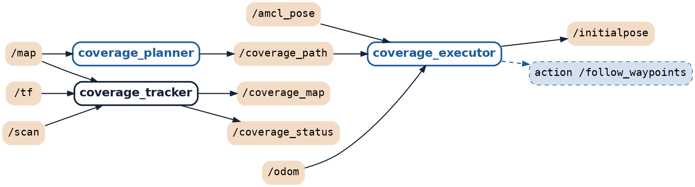

# Robot aspirateur autonome : couverture d'une pièce (ROS 2 Humble, TurtleBot3 Burger)

[](https://github.com/Maximator13/robot-aspirateur-ros2/actions/workflows/tests.yml)


> Projet réalisé seul en 12 h, en école d'ingénieur (IMT Mines Alès, cours ROS 2).

Un TurtleBot3 Burger doit couvrir la surface libre d'une pièce, en simulation (Gazebo) puis sur le
vrai robot avec son LiDAR. Deux stratégies sont comparées avec **la même mesure** :

- **A, aléatoire** (« bump and turn ») : sans carte, avance et tourne d'un angle aléatoire devant un obstacle ;
- **B, planifiée** : balayage boustrophédon calculé sur la carte, exécuté par Nav2 en simulation et par un
  suiveur de points de passage (`coverage_follower`) sur le robot réel.

Sur le robot réel, B atteint 80 % de couverture en environ 2 min (96,5 et 98,4 % en fin de trajet), contre
73 à 75 % en 5 min pour A.

Diaporama de soutenance : [`livrables/Robot_aspirateur_CCPP_ROS2.pptx`](livrables/Robot_aspirateur_CCPP_ROS2.pptx).
Résultats, démarche et limites : [`docs/RESULTATS.md`](docs/RESULTATS.md).
Architecture : [`docs/ARCHITECTURE.md`](docs/ARCHITECTURE.md) · Algorigrammes : [`docs/ALGORIGRAMMES.md`](docs/ALGORIGRAMMES.md) ·
État de l'art : [`docs/ETAT_DE_L_ART.md`](docs/ETAT_DE_L_ART.md) · Journal d'ingénierie : [`docs/JOURNAL.md`](docs/JOURNAL.md) ·
Perspectives : [`docs/PERSPECTIVES.md`](docs/PERSPECTIVES.md).

## Résultats

Tous les chiffres sont recalculés à partir des CSV de `results/` (une ligne par seconde, colonnes
`time, coverage_percent, distance, near_collisions`). Les « % à t s » sont interpolés linéairement entre
deux points CSV, comme dans `scripts/plot_results.py`. Moyenne ± écart-type d'échantillon (n-1).
« non mesuré » : la donnée n'existe pas dans les CSV, rien n'est extrapolé.

### Simulation : `turtlebot3_world`, 13,9 m² atteignables, 600 s par run

| Stratégie | Runs valides | % à 120 s | % à 300 s | % final (600 s) | Distance (m) | near_collisions |
|---|---|---|---|---|---|---|
| A (aléatoire) | 6 (seeds 1 à 6) | 17,3 ± 2,3 | 32,4 ± 6,5 | 52,2 ± 5,7 | 70,4 ± 1,3 | 27,2 ± 4,4 |
| B (boustrophédon + Nav2), tous runs valides | 5 (seeds 1, 2, 3, 5, 6) | 16,3 ± 0,7 | 26,4 ± 6,4 | 43,3 ± 21,8 | 54,2 ± 19,6 | 5,8 ± 10,8 |
| B (Nav2), runs non bloqués seulement | 3 (seeds 1, 2, 5) | 16,2 ± 0,7 | 30,9 ± 0,7 | 59,1 ± 3,4 | 68,1 ± 5,2 | 0 ; 2 ; 0 |

Conditions : départ (-2,0 ; -0,5), 0,15 m/s pour A et B, même nœud de mesure `coverage_tracker`.
A tourne en mode accéléré (validé contre un run en temps réel, `results/comparaison_vitesse/`), B en temps réel
(le mode accéléré a été invalidé pour Nav2, `results/comparaison_vitesse_B/`), configuration Nav2 « T5 ».
Les seeds de B ne changent pas le trajet planifié : seules varient les conditions d'exécution.
80 % n'est atteint par aucun run en simulation. Fiabilité de B : 3 runs réussis sur 7 lancements conformes
au protocole ; B3 et B6 sont bloqués (gardés dans la moyenne), B4 et B7 ont une mesure faussée
(saut de localisation, écartés, `results/invalides/`). A : 6 runs sur 6.

### Robot réel : zone en carton de 1,6 m² (620 cellules), séance du 12/10

| Stratégie | Runs valides | % à 120 s | % à 300 s | Temps pour 80 % | Distance (m) | near_collisions |
|---|---|---|---|---|---|---|
| A (aléatoire) | 2 (seeds 1, 3) | 36,2 ; 30,3 | 73,1 ; 74,8 | non atteint ; non atteint | 19,7 ; 20,9 | 21 ; 19 |
| B (boustrophédon + `coverage_follower`) | 2 | 79,3 ; 75,2 | 98,4 ; non mesuré (arrêt manuel à 170 s, à 96,5 %) | 125 s ; 134 s | 9,8 ; 9,8 | 8 ; 2 |

Conditions : TurtleBot3 Burger réel, LiDAR LDS-02, 0,10 m/s, 300 s prévues, localisation par odométrie seule
(`localization:=static`). Sur le robot réel, B n'est **pas** exécuté par Nav2 mais par le suiveur de waypoints
`coverage_follower` (Nav2 n'a pas pu être rendu opérationnel sur ce robot). Un 3ᵉ run B (incident : waypoints
sautés, 46,8 % à 161 s) est exclu. Valeurs individuelles, pas de moyenne : 2 runs par stratégie.

Courbes : [`results/coverage_vs_time.png`](results/coverage_vs_time.png) (simulation),
[`results/robot_reel/coverage_vs_time_reel_12oct.png`](results/robot_reel/coverage_vs_time_reel_12oct.png) (robot réel).

### Limites

- **Peu de runs** : 6 (A) et 5 (B) en simulation, 2 + 2 sur le robot réel. Aucun test statistique ; les
  plages de A et B se recouvrent en simulation.
- **Conditions différentes entre stratégies** : en simulation, A en mode accéléré et B en temps réel ; A4 et A5
  lancés avec les fenêtres Gazebo et RViz, contrairement au protocole. Sur le robot réel, B est exécuté par un
  suiveur simplifié et non par Nav2 : les chiffres réels ne sont pas comparables à ceux de la simulation.
- **Sources de pose différentes** : en simulation, A est mesuré sur l'odométrie parfaite, B sur la pose AMCL.
  Sur le robot réel, odométrie seule : le repère dérive, surtout pour A (nombreuses rotations).
- **Fiabilité de B** : blocages de Nav2 (TF `map → odom` figée ou contrôleur bloqué), cause non établie.
- **Défaut de mesure connu** : le tracker ne filtre pas les sauts de position (B4 et B7 triés à la main).
- **Une seule pièce** par environnement. near_collisions n'utilise pas le même seuil que l'évitement de A :
  le compteur reste indicatif.

Détail complet : [`docs/RESULTATS.md`](docs/RESULTATS.md).

## Architecture

Nœuds du projet pour la stratégie B en simulation (extrait de `rqt_graph`, nœuds tiers masqués).
Schémas complets avec Nav2 et l'arbre TF : [`docs/ARCHITECTURE.md`](docs/ARCHITECTURE.md).



## Ce que j'ai écrit / ce qui vient de tiers

| Écrit pour ce projet | Repris tel quel (tiers) |
|---|---|
| Message `aspi_interfaces/CoverageStatus` | ROS 2 Humble (`rclpy`, `tf2_ros`, messages standard), RViz 2 |
| Nœuds `random_walker`, `coverage_planner`, `coverage_executor`, `coverage_follower`, `coverage_tracker` | Gazebo Classic et `gazebo_ros` |
| Modules Python purs testés : `planning.py` (masque atteignable, mesure de couverture, boustrophédon), `random_logic.py`, `follow_logic.py`, `progress_check.py` | Nav2 : `nav2_bringup`, AMCL, `map_server`, contrôleur Regulated Pure Pursuit, `nav2_simple_commander` (`BasicNavigator`) |
| Fichiers launch (simulation et robot réel), monde `turtlebot3_world_fast` (copie accélérée de `turtlebot3_world`), monde `zone_reelle` (généré depuis la carte) | TurtleBot3 : modèle du Burger, `turtlebot3_gazebo`, monde `turtlebot3_world`, logiciel embarqué du robot réel |
| Réglage de Nav2 (essais T0 à T5), à partir du `burger.yaml` de `turtlebot3_navigation2` | Cartographer (carte de simulation `world`) |
| Scripts d'analyse et de figures (`scripts/`), outils `make_world_from_map.py`, `make_keepout_mask.py` | numpy, matplotlib, pytest |

## Contenu

| Chemin | Rôle |
|---|---|
| `src/aspi_interfaces/` | Message `CoverageStatus` (% couvert, distance, temps, near_collisions) |
| `src/aspi_bot/aspi_bot/planning.py` | Python pur : masque atteignable, mesure de couverture, boustrophédon |
| `src/aspi_bot/aspi_bot/random_logic.py` | Python pur : machine à états du robot aléatoire |
| `src/aspi_bot/aspi_bot/*_node.py` | Nœuds ROS 2 : `random_walker`, `coverage_planner`, `coverage_executor`, `coverage_follower`, `coverage_tracker` |
| `src/aspi_bot/launch/` | `sim.launch.py` (Gazebo commun), `aspi_random.launch.py` (A), `aspi_planned.launch.py` (B) ; robot réel : `aspi_real_random.launch.py`, `aspi_real_follow.launch.py` |
| `livrables/` | Diaporama de soutenance et documents en PDF |
| `src/aspi_bot/config/nav2_params.yaml` | Configuration Nav2 retenue (essais de réglage : `nav2_params_t*.yaml`) |
| `src/aspi_bot/maps/` | Carte de référence `turtlebot3_world` |
| `src/aspi_bot/test/` | Tests pytest des modules Python purs |
| `scripts/plot_results.py` | Courbes et tableau récapitulatif à partir des CSV |
| `results/` | CSV des runs officiels, figures, `summary.md` ; essais dans les sous-dossiers |

## Construire

```bash
cd ~/ros2_ws
source /opt/ros/humble/setup.bash
colcon build --symlink-install --packages-select aspi_interfaces aspi_bot
source install/setup.bash
```

## Tester (sans ROS)

```bash
cd ~/ros2_ws/src/aspi_bot && python3 -m pytest test/ -q
```

Les mêmes tests tournent sur GitHub Actions à chaque push, sans ROS (Python, numpy et pytest seulement) :
[`.github/workflows/tests.yml`](.github/workflows/tests.yml).

## Lancer

Stratégie A (aléatoire), avec fenêtres Gazebo et RViz :

```bash
ros2 launch aspi_bot aspi_random.launch.py seed:=1
```

Stratégie B (boustrophédon + Nav2) :

```bash
ros2 launch aspi_bot aspi_planned.launch.py seed:=1
```

Arguments utiles :

| Argument | Défaut | Rôle |
|---|---|---|
| `seed` | 1 | Graine (A) ; numéro du run dans le nom du CSV (A et B) |
| `run_duration` | 600.0 | Durée de la mesure, en secondes simulées |
| `headless` | false | `true` : ni fenêtre Gazebo ni RViz |
| `fast` | false | `true` : simulation accélérée, **validée pour A uniquement** |
| `nav2_params` | `config/nav2_params.yaml` | (B) fichier de paramètres Nav2 |
| `plan_transitions` | false | (B) contournements calculés par le planner (essai T4, négatif) |

Chaque run écrit `results/<STRATEGIE>_<seed>_<date>.csv` (colonnes `time, coverage_percent, distance, near_collisions`).

Protocole utilisé pour les résultats officiels (détails dans `docs/RESULTATS.md`) :

```bash
# A : 3 seeds, mode accéléré
ros2 launch aspi_bot aspi_random.launch.py seed:=<N> headless:=true fast:=true
# B : 3 runs, temps réel
ros2 launch aspi_bot aspi_planned.launch.py seed:=<N> headless:=true
```

## Tracer les résultats

```bash
cd ~/ros2_ws && python3 scripts/plot_results.py
# -> results/coverage_vs_time.png, results/coverage_vs_time_runs.png, results/summary.md
```

## Pièges connus (WSL)

- Si Gazebo reste noir : `export LIBGL_ALWAYS_SOFTWARE=1` avant le lancement.
- Le conteneur Nav2 survit parfois à Ctrl+C : vérifier avec `ps` et l'arrêter par son PID.
- Si Nav2 n'est pas actif après environ 90 s (log « Nav2 actif » absent), arrêter et relancer.
