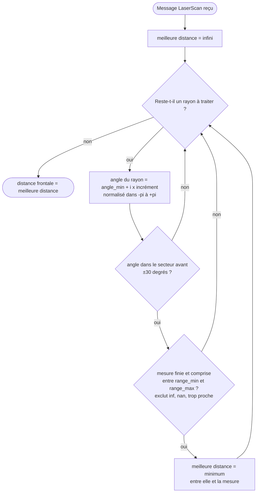
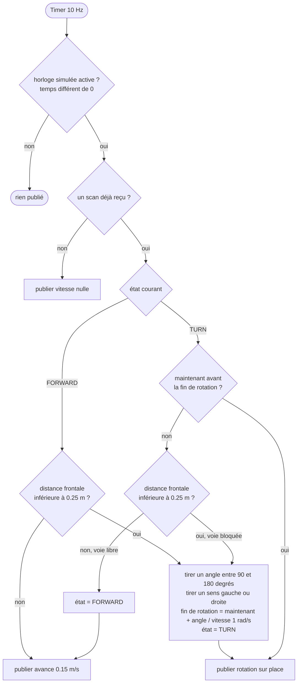
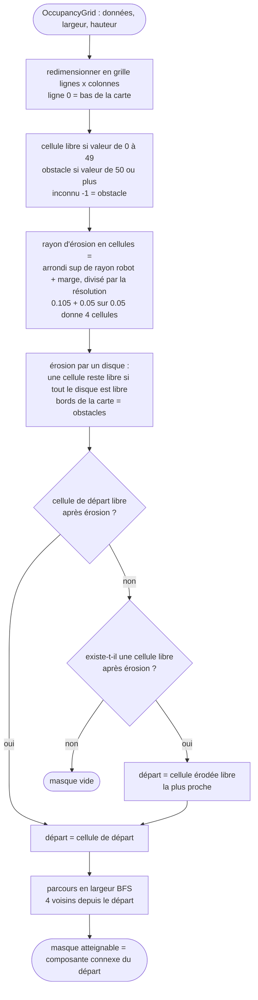
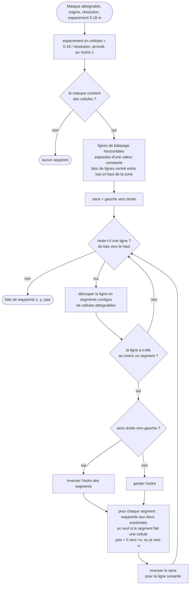
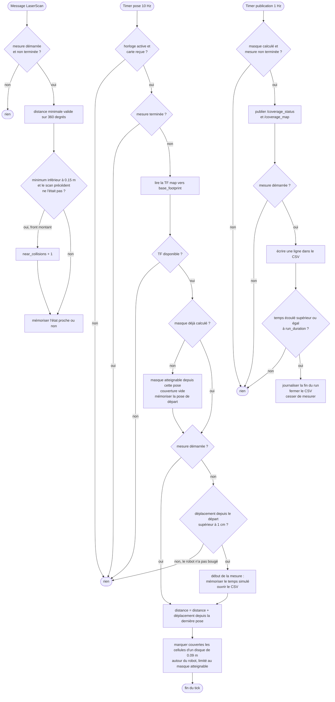

# Algorigrammes

Les slides ne contiennent pas de code : ces algorigrammes les remplacent.
Fidèles à `random_logic.py`, `random_walker_node.py`, `planning.py` et `coverage_tracker_node.py`.
Le planner (stratégie B) est décrit ici au niveau de `planning.py` ; le nœud `coverage_planner` s'y ajoute (voir ARCHITECTURE.md).

---

## 1. random_walker (stratégie A)

### 1.1 Distance frontale (à chaque message `/scan`)

Le scan du TurtleBot3 va de 0 à 2π : l'avant est au début et à la fin du tableau.
La normalisation des angles dans [-π, π] gère ce cas. S'il n'y a aucune mesure valide, la distance vaut l'infini (voie libre).

### 1.2 Machine à états (timer à 10 Hz)

- Deux états seulement : `FORWARD` et `TURN`.
- Le hasard vient d'un générateur local initialisé par `seed` : même graine, même suite de rotations.
- La rotation est temporisée (durée = angle / vitesse angulaire), sans odométrie. L'angle réel peut différer légèrement de l'angle tiré : sans importance pour une marche aléatoire.
- Si la voie est encore bloquée à la fin de la rotation, un nouveau tirage est fait.
- La commande est publiée sur `/cmd_vel` (`geometry_msgs/Twist`) à chaque tick.

---

## 2. Masque atteignable et boustrophédon (`planning.py`)

### 2.1 Masque atteignable

Utilisé par le planner (tracé) et par le tracker (dénominateur du pourcentage).

- L'inconnu est traité comme obstacle : on ne nettoie pas ce qu'on ne connaît pas.
- L'érosion garantit que le centre du robot reste à distance des murs.
- La composante connexe élimine les zones libres inaccessibles depuis le départ.
- Sur la carte `world` : 5564 cellules atteignables, soit 13.9 m².

### 2.2 Balayage boustrophédon

- Les lignes sont centrées : l'excédent est réparti moitié en bas, moitié en haut. L'espacement reste constant et la bande du haut est couverte (correction du jour 1).
- Les waypoints sont les extrémités des segments seulement, orientés dans le sens de passage.
- Une ligne vide ne change pas le sens.
- Limite assumée : ce n'est pas une décomposition cellulaire de Choset. Quand un obstacle coupe une ligne, les segments sont enchaînés dans l'ordre. Le contournement est laissé au planificateur de Nav2.
- Sur la carte `world` : 112 waypoints.

---

## 3. coverage_tracker (mesure commune A et B)

- Trois déclencheurs indépendants : la pose (10 Hz), le scan (5 Hz), la publication (1 Hz).
- Le pourcentage est le nombre de cellules couvertes dans le masque atteignable, divisé par la taille du masque.
- La mesure démarre au premier déplacement : le temps d'activation de Nav2 (stratégie B) n'est pas compté.
- La quasi-collision est comptée sur front montant : un passage sous le seuil compte pour un événement.
- Le seuil est de 0.15 m, car `range_min` du LiDAR (0.12 m) dépasse le rayon du robot (0.105 m).
- Le temps du run est le temps simulé.
