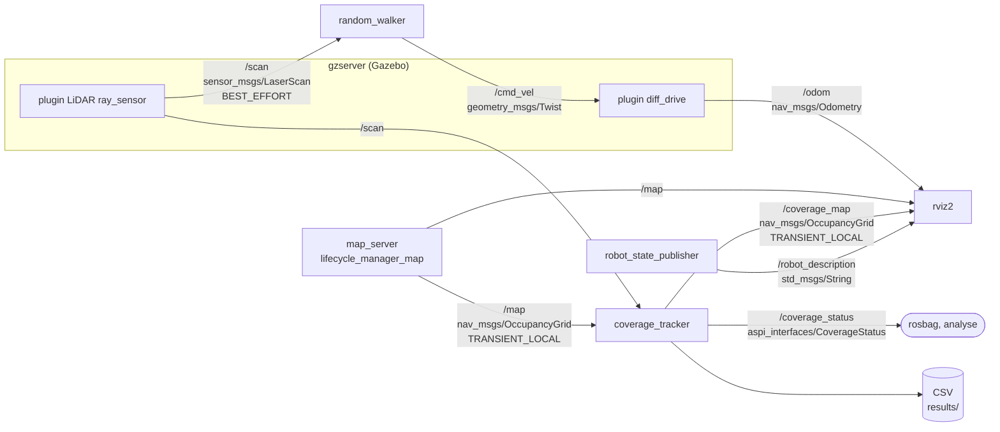
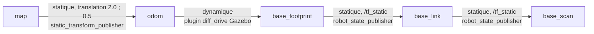
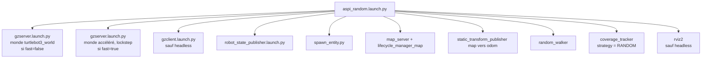
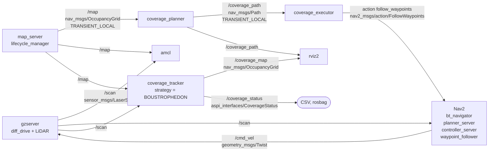
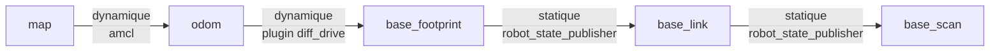
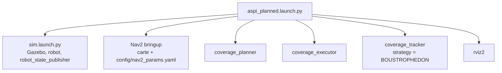

# Architecture système

Version du jour 2. Stratégie A : complète, relue contre le code. Stratégie B : schéma prévu, en cours d'écriture.

Sources vérifiées : `launch/aspi_random.launch.py`, `random_walker_node.py`, `coverage_tracker_node.py`,
`aspi_interfaces/msg/CoverageStatus.msg`, `turtlebot3_burger/model.sdf` (plugins Gazebo), `rviz/aspi.rviz`.

---

## 1. Stratégie A : aléatoire (bump and turn)

Le robot n'utilise pas la carte. Elle sert uniquement de vérité terrain au tracker.

### 1.1 Schéma nœuds et topics

Points à retenir :

- `/clock` (`rosgraph_msgs/Clock`, BEST_EFFORT) est publié par gzserver. Tous les nœuds ont `use_sim_time = True`. Il n'est pas dessiné pour la lisibilité.
- Le LiDAR publie à 5 Hz. `random_walker` commande à 10 Hz (timer). Le tracker lit la pose à 10 Hz et publie à 1 Hz.
- `spawn_entity.py` (nœud éphémère) insère le burger dans Gazebo, puis se termine. Timeout de 120 s.
- Le plugin `joint_state` publie aussi `/joint_states` (utilisé par `robot_state_publisher`) et l'IMU publie `/imu`. Non utilisés par nos nœuds.
- `/coverage_status` est enregistré dans le rosbag du run avec `/odom` et `/tf`.
- `gzclient` et `rviz2` sont absents en mode `headless:=true`.

### 1.2 Arbre TF

Pourquoi `map → odom` vaut (2.0, 0.5) et non l'identité :

- Le plugin `diff_drive` publie `odom` dans le repère du monde Gazebo. Au spawn, `odom → base_footprint` vaut (-2.0, -0.5).
- La carte de référence a son origine au spawn.
- `map → odom` est donc la translation de moins la position de spawn. Le launch la calcule : `-spawn_x`, `-spawn_y`.
- Vérifié par lecture de `/odom` (voir JOURNAL, bug du premier run A).
- Limite : la dérive d'odométrie est négligée en simulation. Un décalage résiduel d'environ 4 cm existe (origine Cartographer), inférieur à une cellule de 5 cm.

Le tracker lit `map → base_footprint` (composée de la chaîne ci-dessus).

### 1.3 Launch : `aspi_random.launch.py`

Arguments du launch :

| Argument | Défaut | Rôle |
|---|---|---|
| `seed` | 1 | Graine du tirage aléatoire (walker, tracker pour le nom du CSV, et gzserver) |
| `run_duration` | 600.0 | Durée du run en secondes simulées (typé float) |
| `headless` | false | `true` : ni gzclient ni RViz |
| `fast` | false | `true` : monde copié avec `real_time_update_rate = 0`, gzserver en lockstep |
| `spawn_x`, `spawn_y` | -2.0, -0.5 | Position de spawn dans le monde ; sert aussi à calculer `map → odom` |
| `map` | `maps/world.yaml` | Carte de référence (vérité terrain) |

### 1.4 Message `aspi_interfaces/msg/CoverageStatus`

| Champ | Type | Sens |
|---|---|---|
| `stamp` | `builtin_interfaces/Time` | Horodatage (temps simulé) |
| `strategy` | `string` | `RANDOM` ou `BOUSTROPHEDON` |
| `coverage_percent` | `float32` | Cellules couvertes / cellules atteignables |
| `distance_travelled` | `float32` | Mètres |
| `elapsed_time` | `float32` | Secondes depuis le début de la mesure |
| `near_collisions` | `uint32` | Passages sous `near_collision_distance` (0.15 m), front montant, LiDAR 360° |

### 1.5 CSV écrit par le tracker

- Fichier : `results/<strategie>_<seed>_<AAAAMMJJ-HHMMSS>.csv`.
- Colonnes : `time,coverage_percent,distance,near_collisions`.
- Une ligne par seconde simulée, à partir du début de la mesure (1er déplacement supérieur à 1 cm).
- Le fichier n'est ouvert qu'à ce moment : pas de CSV vide.
- Le tracker cesse de mesurer après `run_duration` et ferme le fichier.

---

## 2. Stratégie B : planifiée avec Nav2 (EN COURS)

> **Statut : schéma PRÉVU** d'après le contrat de `docs/TASKS.md` (jour 2). Le code des nœuds et
> `aspi_planned.launch.py` sont en cours d'écriture. Ce schéma sera **vérifié contre le code et contre
> `rqt_graph`** une fois le premier run B réalisé. Les noms de topics internes de Nav2 ne sont pas
> détaillés : seuls ceux du contrat le sont.

### 2.1 Schéma nœuds, topics et action

Le nœud `coverage_executor` utilise `BasicNavigator` : pose initiale, attente de l'activation de Nav2, puis `followWaypoints`.
`random_walker` n'est pas lancé en stratégie B.

### 2.2 Arbre TF prévu

Différence avec A : `map → odom` vient d'AMCL, pas d'un TF statique. Le tracker lit le même `map → base_footprint`.
À vérifier : AMCL part de la pose initiale fixée par l'executor. En B, la dérive d'odométrie est corrigée par le scan matching.

### 2.3 Launch prévu : `aspi_planned.launch.py`

Paramètres de contrat : `sweep_spacing` 0.18 m, `robot_radius` 0.105 m, `safety_margin` 0.05 m,
`waypoint_follower.stop_on_failure = false`, `xy_goal_tolerance` 0.15 m.
Le mode accéléré (`fast`) ne sera appliqué à B qu'après vérification croisée (ticket J2-09).

---

## 3. Pourquoi le tracker est commun aux deux stratégies

- Une comparaison honnête exige la même règle de mesure pour A et B.
- Même source de pose : TF `map → base_footprint`.
- Même dénominateur : le masque atteignable calculé par la même fonction de `planning.py`.
- Même rayon de nettoyage (0.09 m) et même seuil de quasi-collision (0.15 m).
- Même début de mesure : le premier déplacement. L'activation de Nav2 en B n'est donc pas comptée.
- Seul le champ `strategy` change, et il nomme le CSV.

## 4. Choix de conception

- **Python pur testable, nœuds fins.** Les algorithmes (`planning.py`, `random_logic.py`) n'importent pas ROS. Ils sont testés avec `pytest` sur de petites grilles. Un nœud = une responsabilité, simple à expliquer.
- **Masque atteignable partagé.** Le planner l'utilise pour tracer le balayage, le tracker pour le dénominateur. Le pourcentage est donc au plus 100 % et comparable.
- **Début de mesure au premier déplacement.** Les temps de démarrage varient sous WSL (spawn, activation de Nav2). Le temps du CSV ne les inclut pas.
- **Rotation du random_walker en temps.** Le nœud n'a que `/scan` en entrée, avec l'horloge simulée.
- **Carte figée au premier `/map`.** La vérité terrain ne change pas pendant un run.
