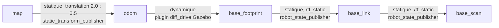
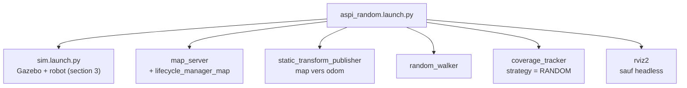
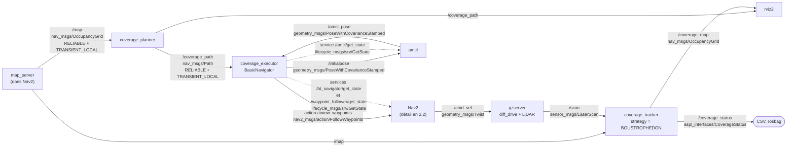
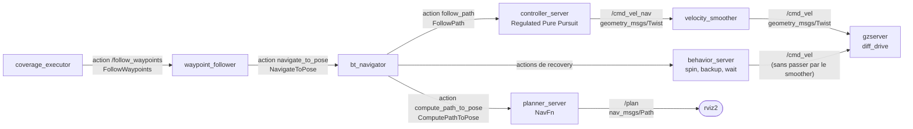
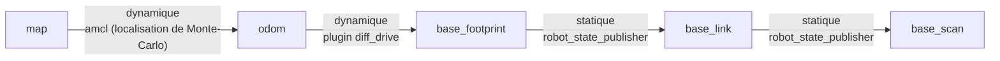
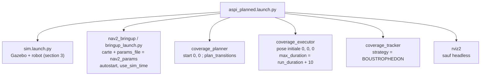
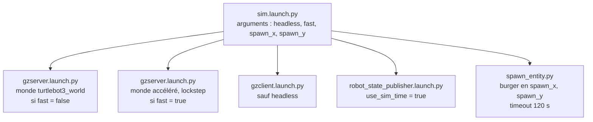
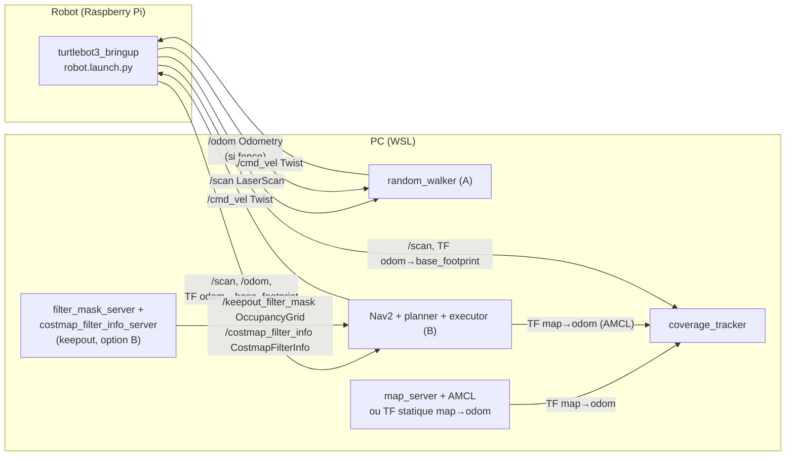

# Architecture système

Version du jour 2. Stratégies A et B relues contre le code.

Sources vérifiées : `launch/sim.launch.py`, `launch/aspi_random.launch.py`, `launch/aspi_planned.launch.py`,
`random_walker_node.py`, `coverage_planner_node.py`, `coverage_executor_node.py`, `coverage_tracker_node.py`,
`config/nav2_params.yaml`, `aspi_interfaces/msg/CoverageStatus.msg`, `turtlebot3_burger/model.sdf` (plugins Gazebo),
`rviz/aspi.rviz`, et le `bringup_launch.py` / `navigation_launch.py` de `nav2_bringup` (Humble, installé).

---

## 1. Stratégie A : aléatoire (bump and turn)

Le robot n'utilise pas la carte. Elle sert uniquement de vérité terrain au tracker.

### 1.1 Schéma nœuds et topics

Points à retenir :

- `/clock` (`rosgraph_msgs/Clock`, BEST_EFFORT) est publié par gzserver. Tous les nœuds ont `use_sim_time = True`. Il n'est pas dessiné pour la lisibilité.
- Le LiDAR publie à 5 Hz. `random_walker` commande à 10 Hz (timer). Le tracker lit la pose à 10 Hz et publie à 1 Hz.
- `spawn_entity.py` (nœud éphémère) insère le burger dans Gazebo, puis se termine. Timeout de 120 s.
- Le plugin `joint_state` publie aussi `/joint_states` (utilisé par `robot_state_publisher`) et l'IMU publie `/imu`. Non utilisés par nos nœuds.
- `/coverage_status` est enregistré dans le rosbag du run avec `/odom` et `/tf`.
- `gzclient` et `rviz2` sont absents en mode `headless:=true`.

### 1.2 Arbre TF

Pourquoi `map → odom` vaut (2.0, 0.5) et non l'identité :

- Le plugin `diff_drive` publie `odom` dans le repère du monde Gazebo. Au spawn, `odom → base_footprint` vaut (-2.0, -0.5).
- La carte de référence a son origine au spawn.
- `map → odom` est donc la translation de moins la position de spawn. Le launch la calcule : `-spawn_x`, `-spawn_y`.
- Vérifié par lecture de `/odom` (voir JOURNAL, bug du premier run A).
- Limite : la dérive d'odométrie est négligée en simulation. Un décalage résiduel d'environ 4 cm existe (origine Cartographer), inférieur à une cellule de 5 cm.

Le tracker lit `map → base_footprint` (composée de la chaîne ci-dessus).

### 1.3 Launch : `aspi_random.launch.py`

La simulation (Gazebo, robot) vient de `sim.launch.py`, commun aux deux stratégies (voir section 3).

Arguments du launch :

| Argument | Défaut | Rôle |
|---|---|---|
| `seed` | 1 | Graine du tirage aléatoire (walker, nom du CSV par le tracker, et gzserver) |
| `run_duration` | 600.0 | Durée du run en secondes simulées (typé float) |
| `headless` | false | `true` : ni gzclient ni RViz (transmis à `sim.launch.py`) |
| `fast` | false | `true` : monde accéléré (transmis à `sim.launch.py`) |
| `spawn_x`, `spawn_y` | -2.0, -0.5 | Position de spawn ; sert aussi à calculer `map → odom` |
| `map` | `maps/world.yaml` | Carte de référence (vérité terrain) |

### 1.4 Message `aspi_interfaces/msg/CoverageStatus`

| Champ | Type | Sens |
|---|---|---|
| `stamp` | `builtin_interfaces/Time` | Horodatage (temps simulé) |
| `strategy` | `string` | `RANDOM` ou `BOUSTROPHEDON` |
| `coverage_percent` | `float32` | Cellules couvertes / cellules atteignables |
| `distance_travelled` | `float32` | Mètres |
| `elapsed_time` | `float32` | Secondes depuis le début de la mesure |
| `near_collisions` | `uint32` | Passages sous `near_collision_distance` (0.15 m), front montant, LiDAR 360° |

### 1.5 CSV écrit par le tracker

- Fichier : `results/<strategie>_<seed>_<AAAAMMJJ-HHMMSS>.csv`.
- Colonnes : `time,coverage_percent,distance,near_collisions`.
- Une ligne par seconde simulée, à partir du début de la mesure (1er déplacement supérieur à 1 cm).
- Le fichier n'est ouvert qu'à ce moment : pas de CSV vide.
- Le tracker cesse de mesurer après `run_duration` et ferme le fichier.

---

## 2. Stratégie B : planifiée avec Nav2

Le robot utilise la carte : AMCL le localise, le planner calcule le balayage, Nav2 l'exécute.
`random_walker` n'est pas lancé. Le schéma est découpé en trois : nœuds du projet, intérieur de Nav2, TF.

### 2.1 Schéma des nœuds du projet

Rôles :

- `coverage_planner` : une publication par carte reçue. Départ de calcul en (0, 0), l'origine de la carte (spawn). Logique dans `planning.py`.
- `coverage_executor` : un `BasicNavigator` qui enchaîne pose initiale, attente de Nav2, `FollowWaypoints`, suivi. Il s'arrête de lui-même à `max_duration` (= `run_duration` + 10 s).
- Attente de Nav2 (traits pointillés du schéma) : l'executor interroge les services `get_state` (`lifecycle_msgs/srv/GetState`) de `amcl`, `bt_navigator` et `waypoint_follower`, chacun avec un délai. Séquence : amcl actif, pose initiale republiée jusqu'à réception de `/amcl_pose`, bt_navigator actif, waypoint_follower actif, serveur d'action `FollowWaypoints` prêt, envoi des waypoints (jusqu'à 5 essais si le but est refusé). Détail dans `ALGORIGRAMMES.md`, section 3.2.
- `coverage_tracker` : identique à A, seul `strategy` change.
- `amcl` est dessiné à part du bloc Nav2 car l'executor dialogue directement avec lui (pose initiale, lecture de `/amcl_pose`).
- `/scan` va aussi vers AMCL et les costmaps de Nav2 (non dessiné ici, voir 2.2).

### 2.2 Intérieur de Nav2 (chaîne de commande)

Points à retenir :

- Les noms `/cmd_vel_nav` (sortie du contrôleur) et `/cmd_vel` (sortie du smoother) viennent des remappings de `navigation_launch.py` (vérifié, et mesuré : JOURNAL, « Mesure de la fréquence de contrôle »).
- Le smoother tourne à 20 Hz. `/cmd_vel` est donc à environ 21 Hz, alors que le contrôleur est à 10 Hz.
- Les nœuds `map_server`, `amcl`, `planner_server`, `controller_server`, `bt_navigator`, `waypoint_follower`, `smoother_server`, `behavior_server`, `velocity_smoother` et les deux lifecycle managers sont chargés comme composants dans un conteneur `nav2_container` (`component_container_isolated`, `use_composition` vaut True par défaut dans `bringup_launch.py`).
- Les costmaps locale et globale (couches obstacle, voxel, inflation) vivent dans `controller_server` et `planner_server`. Elles lisent `/scan` (non dessiné).
- Le contrôleur est Regulated Pure Pursuit (essai T3, retenu). Le planner global est NavFn, non modifié.
- `waypoint_follower.stop_on_failure` est à false : un waypoint en échec est sauté puis listé dans `missed_waypoints`.
- L'algorigramme du `coverage_executor` est dans `ALGORIGRAMMES.md`, section 3.

### 2.3 Arbre TF

Différence avec A : `map → odom` vient d'AMCL, pas d'un TF statique.

- AMCL est un filtre particulaire (500 à 2000 particules, modèle de mesure `likelihood_field`) : localisation de Monte-Carlo, pas du scan matching.
- Il estime la pose du robot sur la carte, et publie la correction `map → odom`.
- Avant la pose initiale (fixée par l'executor via `/initialpose`), AMCL ne publie pas cette TF : le tracker attend.
- Le tracker lit le même `map → base_footprint` qu'en A.
- Fragilité observée : la TF `map → odom` vue par Nav2 est restée figée (« Transform data too old ») en mode accéléré, et aussi en temps réel (essai T1, run officiel B3). Voir section 4.

### 2.4 Launch : `aspi_planned.launch.py`

Arguments du launch :

| Argument | Défaut | Rôle |
|---|---|---|
| `seed` | 1 | Numéro du run : nomme le CSV (le balayage est déterministe) |
| `map` | `maps/world.yaml` | Carte pour Nav2 et vérité terrain du tracker |
| `nav2_params` | `config/nav2_params.yaml` | Paramètres Nav2. Nommé ainsi car `params_file` fuit vers `gzserver.launch.py` (JOURNAL, incidents d'exploitation) |
| `run_duration` | 600.0 | Durée du run en secondes simulées |
| `headless` | false | `true` : ni gzclient ni RViz |
| `fast` | false | `true` : monde accéléré. **Déconseillé pour B** (section 4) |
| `plan_transitions` | false | `true` : contournements calculés par le planner. Désactivé (essai T4 négatif) |
| `spawn_x`, `spawn_y` | -2.0, -0.5 | Position de spawn (transmise à `sim.launch.py`) |

### 2.5 Config Nav2 : écarts avec le `burger.yaml` de Humble

Base : `/opt/ros/humble/share/turtlebot3_navigation2/param/humble/burger.yaml`. Copie dans `src/aspi_bot/config/nav2_params.yaml` (jamais de modification de `/opt/ros`). Chaque écart est marqué `# aspi` dans le fichier. Les essais sont détaillés dans `docs/JOURNAL.md`.

| # | Paramètre | Original | aspi | Pourquoi |
|---|---|---|---|---|
| 1 | `use_sim_time` | selon nœud | True partout | Simulation Gazebo |
| 2 | `general_goal_checker.xy_goal_tolerance` | 0.25 m | 0.15 m | Espacement de balayage effectif de 0.20 m (0.18 arrondi sur la grille de 0.05) : 0.25 couperait les extrémités des lignes |
| 3 | `waypoint_follower.loop_rate` | 2000 | 20 | 2000 Hz saturait le CPU (37 000 lignes « Processing waypoint ») ; 20 est le défaut Nav2. Essai T1 |
| 4 | inflation des deux costmaps | rayon 1.0 (locale) et 0.55 (globale), échelle 3.0 | rayon 0.30, échelle 10.0 | Le planner garantit déjà une marge de 0.155 m. Une large inflation repousse le plan global de NavFn loin des obstacles (nos lignes de balayage ne sont pas modifiées). Essai T2 |
| 5 | `controller_server.FollowPath` | DWB | Regulated Pure Pursuit, vitesse 0.15 m/s, visée fixe 0.3 m, rotation sur place à 1.0 rad/s | DWB restait bloqué devant un pilier. Vitesses alignées sur `random_walker` pour une comparaison équitable. Essai T3 retenu : 28.5 % à 300 s contre 21.9 % |
| 6 | `FollowPath.approach_velocity_scaling_dist` | 0.6 m (défaut Humble) | 0.2 m | Le robot ralentissait sur les 0.6 derniers mètres de chaque waypoint. 0.2 reste juste au-dessus de `xy_goal_tolerance` (0.15). Essai T5 |
| 7 | `waypoint_follower.waypoint_pause_duration` | 200 ms | 0 | Pause inutile pour un balayage. Essai T5 : 59.7 % contre 54.1 % à 600 s (un run par configuration) |

Vérifiés sans changement : `amcl.robot_model_type = nav2_amcl::DifferentialMotionModel`, `waypoint_follower.stop_on_failure = false`.
La section `recoveries_server` est ignorée en Humble (le serveur s'appelle `behavior_server`) : valeurs par défaut appliquées.

Essais T0 à T5 : T0 original, T1 loop_rate, T2 inflation, T3 Regulated Pure Pursuit, T4 contournements du planner (impasse), T5 approche et pause aux waypoints.
Configuration officielle : T5 (T3 plus les écarts 6 et 7), dans `config/nav2_params.yaml`.

---

## 3. Launch commun : `sim.launch.py`

Inclus par `aspi_random.launch.py` et `aspi_planned.launch.py`. Les deux stratégies tournent ainsi dans le même monde, avec le même robot, au même point de départ.

Le monde accéléré est une copie de `turtlebot3_world` dans `aspi_bot/worlds/`, avec `real_time_update_rate = 0`.

---

## 4. Modes de simulation

Deux modes existent. Le critère reste le temps simulé : le % couvert est tracé en fonction de l'horloge `/clock`.

| | Stratégie A | Stratégie B |
|---|---|---|
| Mode retenu | Accéléré (`fast:=true`, headless) | Temps réel |
| Validation | 5 critères fixés avant les runs, tous OK | 5 critères fixés avant les runs, 3 KO |
| Facteur (temps simulé / temps mural) | 2.84 à 3.08 (600 s simulées en environ 3.5 min) | 0.84 à 0.94 (temps réel) |

**A en accéléré.** Critères : `/scan` à 5 Hz, `/cmd_vel` à 10 Hz, vitesse moyenne, near_collisions, % final.
Mesures : 5.00 Hz, 9.99 Hz, 0.120 m/s, 24 contre 27, 54.4 % contre 58.1 %. Les courbes sont superposées jusqu'à environ 5 min, puis divergent (marche aléatoire).

**B en temps réel.** Même vérification croisée (seed 1, 600 s) :

- Fréquence de `/cmd_vel_nav` : 4.42 Hz en accéléré contre 9.56 Hz en temps réel (critère KO).
- En accéléré, la TF `map → odom` d'AMCL reste figée à 89 s simulées (2 292 messages « Transform data too old »). La TF `map → odom` vue par Nav2 reste figée. Le même gel a eu lieu en temps réel (T1 et run officiel B3, où le rosbag montre AMCL publiant normalement).
- Waypoints atteints : 8 contre 69 (KO). Incidents : 85 contre 1 (KO).
- Le % final paraît proche (56.8 % contre 54.1 %) mais les courbes divergent (53.6 % contre 29.0 % à 300 s) : le critère seul est trompeur.
- Cause probable (non démontrée) : les boucles de Nav2 sont cadencées en temps mural.

**Conséquence pour la comparaison.** A et B sont comparées en temps simulé, chacune dans un mode dont la fidélité est vérifiée.
Limites : modes différents, 3 runs de B en temps réel dont un bloqué (B3), facteur d'accélération dépendant de la charge de la machine.
Runs d'essai B (réglage) : T3 (seed 1, 600 s, temps réel) 54.1 % de couverture, 61.9 m, 1 near_collision, 69 waypoints sur 112 ; T5 (seed 5) 59.7 %, 69.8 m, 73 waypoints. Résultats officiels (config T5) : A 51.0 ± 6.7 % (3 seeds), B 44.1 ± 23.4 % (3 runs, dont B3 bloqué à 17.2 %). Détail dans `docs/RESULTATS.md`.
Détails : `docs/JOURNAL.md`, entrées « Décision : simulation accélérée » et « vérification croisée ».

---

## 5. Pourquoi le tracker est commun aux deux stratégies

- Une comparaison honnête exige la même règle de mesure pour A et B.
- Même source de pose : TF `map → base_footprint`.
- Même dénominateur : le masque atteignable calculé par la même fonction de `planning.py`.
- Même rayon de nettoyage (0.09 m demandé, arrondi à 2 cellules, soit 0.10 m appliqué) et même seuil de quasi-collision (0.15 m).
- Même début de mesure : le premier déplacement. L'activation de Nav2 en B n'est donc pas comptée.
- Seul le champ `strategy` change, et il nomme le CSV.

## 6. Choix de conception

- **Python pur testable, nœuds fins.** Les algorithmes (`planning.py`, `random_logic.py`) n'importent pas ROS. Ils sont testés avec `pytest` sur de petites grilles. Un nœud = une responsabilité, simple à expliquer.
- **Masque atteignable partagé.** Le planner l'utilise pour tracer le balayage, le tracker pour le dénominateur. Le pourcentage est donc au plus 100 % et comparable.
- **Début de mesure au premier déplacement.** Les temps de démarrage varient sous WSL (spawn, activation de Nav2). Le temps du CSV ne les inclut pas.
- **Rotation du random_walker en temps.** Le nœud n'a que `/scan` en entrée, avec l'horloge simulée.
- **Carte figée au premier `/map`.** La vérité terrain ne change pas pendant un run.
- **Simulation commune.** `sim.launch.py` évite toute divergence de monde ou de robot entre A et B.

---

## 7. Robot réel (préparation)

Non encore exécuté sur le robot : section écrite d'après les launch `aspi_real_random.launch.py` et `aspi_real_planned.launch.py`.

**Répartition.** Pas de Gazebo ni de `sim.launch.py`.

- Le robot exécute `turtlebot3_bringup robot.launch.py`. Il publie `/scan`, `/odom` et la TF `odom → base_footprint`.
- Le PC exécute nos nœuds, Nav2 et RViz. Les deux machines se parlent par DDS.
- `use_sim_time` vaut `false` par défaut.
- Les CSV vont dans `results/robot_reel/`.
- Vitesse réduite à 0.10 m/s.

**Stratégie A (`aspi_real_random.launch.py`).**

- `random_walker` lit `/scan`. Il lit aussi `/odom` (`nav_msgs/msg/Odometry`) uniquement si la barrière `fence` est active. La barrière est un rectangle en repère odom.
- La mesure a besoin de la TF `map → odom`. Argument `localization` :
  - `amcl` (défaut) : `map_server` + AMCL via `localization_launch.py`, pose initiale (0, 0, 0) ;
  - `static` : TF statique identité en repli.
- Le robot n'utilise pas la carte : elle ne sert qu'à la mesure.

**Stratégie B (`aspi_real_planned.launch.py`).**

- Nav2 complet (`bringup_launch.py`) avec `nav2_params_real.yaml` (0.10 m/s).
- Keepout optionnel (`keepout:=true`) :
  - `filter_mask_server` publie `/keepout_filter_mask` (`nav_msgs/msg/OccupancyGrid`) ;
  - `costmap_filter_info_server` publie `/costmap_filter_info` (`nav2_msgs/msg/CostmapFilterInfo`) ;
  - le plugin `KeepoutFilter` est activé dans les deux costmaps ;
  - un `lifecycle_manager_keepout` active les deux serveurs.
- `allowed_area` (repère map) restreint le balayage du planner ET la mesure du tracker. Sans cela, des waypoints tomberaient dans la zone interdite.

Dans la stratégie B, la TF `map → odom` vient de l'AMCL de Nav2 ; dans la stratégie A, de `LOC`. Le tracker, commun, lit `/scan` et la TF.
