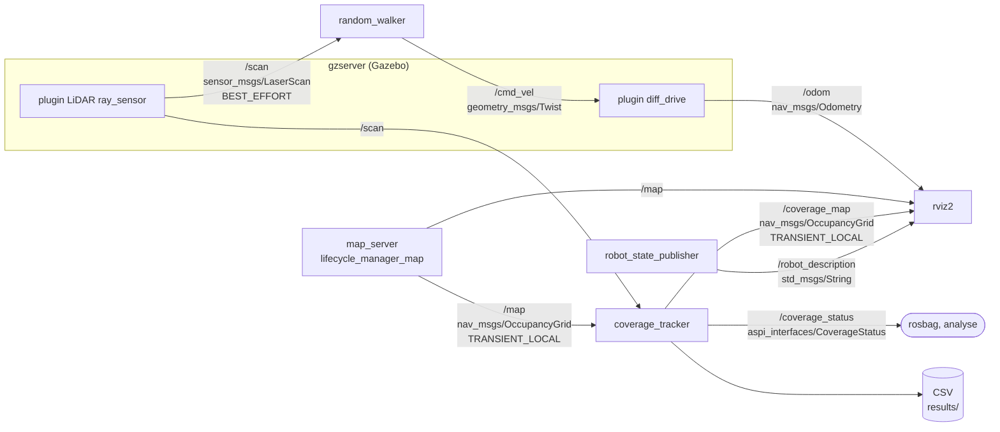
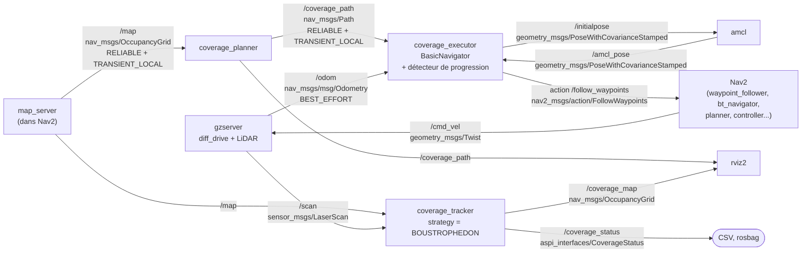
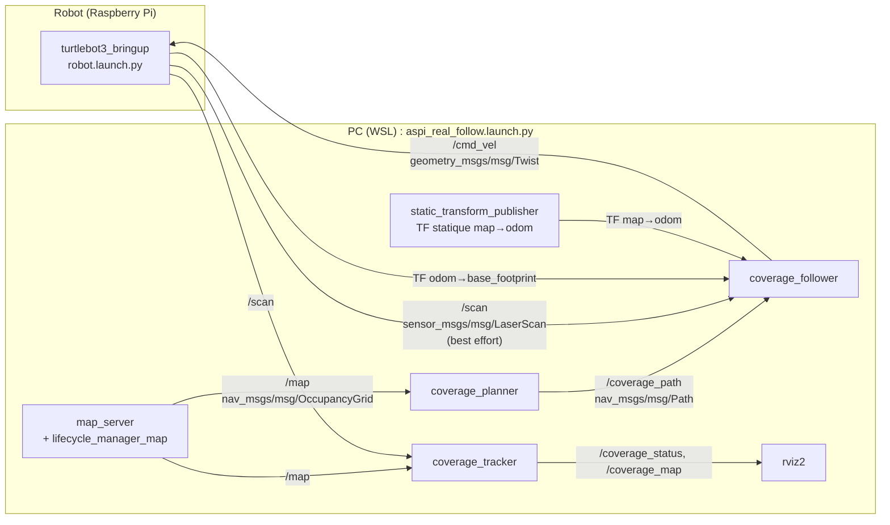

# Fiche de préparation à la soutenance (pour le binôme)

Objectif : comprendre le projet en environ une heure, sans l'avoir vu.
Tous les chiffres viennent de `docs/RESULTATS.md`, `docs/JOURNAL.md`, des CSV de `results/` et du code.
Quand un point n'est pas établi, la fiche le dit (voir la section 15).

Plan de lecture conseillé :

| Temps | Sections |
|---|---|
| 10 min | 1, 2, 3 (le projet, le vocabulaire, le système) |
| 15 min | 4, 5 (les algorithmes) |
| 15 min | 6, 7 (démarche et résultats) |
| 10 min | 8, 9, 10 (bugs, limites, garde-fous) |
| 10 min | 11, 12, 13 (questions, répartition, démo) |

---

## 1. Le projet en 5 phrases

1. Un robot aspirateur doit passer sur toute la surface libre d'une pièce. C'est le problème métier de la couverture de zone, appelé CCPP (Complete Coverage Path Planning) dans la littérature.
2. Nous utilisons un TurtleBot3 Burger, d'abord en simulation Gazebo (pièce `turtlebot3_world`, 13,9 m² atteignables), puis sur un robot réel dans une zone en carton d'environ 1,6 m².
3. Nous comparons deux stratégies : A, aléatoire sans carte (le robot avance et tourne au hasard devant un obstacle), et B, planifiée (un balayage en lignes parallèles calculé sur la carte).
4. Un même nœud de mesure, `coverage_tracker`, évalue A et B avec la même règle et le même dénominateur : la comparaison est honnête.
5. Résultat principal : en simulation, 80 % n'est atteint par aucune stratégie en 10 min (A 51,0 ± 6,7 %, B 44,1 ± 23,4 % sur 3 runs, un run de B bloqué). Sur le robot réel, B atteint 80 % en 125 à 134 s alors que A ne l'atteint pas en 300 s, mais avec 2 runs par stratégie et un exécutant de B différent de la simulation.

Ce qui est évalué : la démarche d'ingénierie (problème, options, solution, mesure, leçons), pas un résultat parfait.

---

## 2. Vocabulaire minimal

| Terme | En une ligne |
|---|---|
| CCPP | Complete Coverage Path Planning : trouver un trajet qui passe sur tout l'espace libre d'une zone. |
| Boustrophédon | Balayage en lignes parallèles, de sens alterné, « comme le bœuf qui laboure ». |
| OccupancyGrid | Message ROS `nav_msgs/OccupancyGrid` : carte en grille, une valeur par cellule (0 à 100 = probabilité d'obstacle, -1 = inconnu). Ici 0,05 m par cellule. |
| Érosion | On « rogne » l'espace libre d'une marge autour des obstacles, pour que le centre du robot reste loin des murs. |
| Composante connexe | Ensemble de cellules libres reliées entre elles. On garde celle qui contient le départ. |
| TF | Arbre de repères ROS (transformations entre `map`, `odom`, `base_footprint`...). |
| `map` | Repère fixe de la carte. |
| `odom` | Repère de l'odométrie : le robot y part de zéro et la position dérive peu à peu. |
| `base_footprint` | Repère attaché au robot, posé au sol sous son centre. |
| AMCL | Localisation de Monte-Carlo : filtre à particules qui recale le LiDAR sur la carte et publie la TF `map → odom`. |
| Costmap | Carte de coûts de Nav2 : les obstacles sont « gonflés » (inflation) pour que le robot les évite. |
| Waypoint | Point de passage (x, y, orientation) donné au robot. |
| QoS BEST_EFFORT | Qualité de service : messages non garantis. Le LiDAR publie ainsi ; l'abonné doit demander la même chose (`qos_profile_sensor_data`), sinon il ne reçoit rien. |
| QoS TRANSIENT_LOCAL | Le dernier message est conservé et renvoyé aux abonnés tardifs. Utilisé pour `/map` et `/coverage_path` (publiés une seule fois). |
| `use_sim_time` | Les nœuds lisent l'horloge `/clock` de Gazebo au lieu de l'heure de la machine. Oublié, il provoque des erreurs TF « extrapolation ». |
| near_collision | Passage du LiDAR sous un seuil de distance (0,15 m en simulation, 0,20 m sur le robot réel), compté sur front montant. |
| Odométrie | Position estimée en comptant les tours de roues. Dérive, surtout à chaque rotation sur place. |
| Seed | Graine du générateur aléatoire : même graine, même suite de rotations. |

---

## 3. Le système

### 3.1 Les nœuds

| Nœud | Entrées | Sorties | Rôle |
|---|---|---|---|
| `random_walker` (A) | `/scan` (`sensor_msgs/LaserScan`) | `/cmd_vel` (`geometry_msgs/Twist`) | Machine à deux états : avance, tourne au hasard devant un obstacle. |
| `coverage_planner` (B) | `/map` (`nav_msgs/OccupancyGrid`) | `/coverage_path` (`nav_msgs/Path`) | Calcule le balayage boustrophédon. Une publication par carte reçue. |
| `coverage_executor` (B, simulation) | `/coverage_path`, `/odom`, `/amcl_pose` | action `/follow_waypoints`, `/initialpose` | Fixe la pose initiale, attend Nav2, envoie les waypoints, surveille. |
| `coverage_follower` (B, robot réel) | `/coverage_path`, `/scan`, TF `map → base_footprint` | `/cmd_vel` | Remplace Nav2 : tourne vers le waypoint, puis avance. |
| `coverage_tracker` (A et B) | TF `map → base_footprint`, `/map`, `/scan` | `/coverage_status` (`aspi_interfaces/CoverageStatus`), `/coverage_map`, CSV | Mesure commune : % couvert, distance, near_collisions. |
| `map_server` | fichier carte | `/map` | Sert la carte (vérité terrain pour A). |
| Nav2 + AMCL (B, simulation) | `/map`, `/scan`, `/odom` | `/cmd_vel`, TF `map → odom` | Localise et exécute le trajet. |
| `rviz2` | topics ci-dessus | affichage | Carte, trajet, couverture, scan. |

Le message `CoverageStatus` contient : `stamp`, `strategy` (RANDOM ou BOUSTROPHEDON), `coverage_percent`, `distance_travelled`, `elapsed_time`, `near_collisions`.

### 3.2 Schéma stratégie A (simulation)



À dire : le robot n'utilise pas la carte. Elle sert seulement au tracker.

### 3.3 Schéma stratégie B (simulation, avec Nav2)



Détails utiles si le jury creuse :

- Dans Nav2, la chaîne est : `waypoint_follower` (action `FollowWaypoints`) puis `bt_navigator` (action `NavigateToPose`), puis `planner_server` (NavFn, chemin global) et `controller_server` (Regulated Pure Pursuit, suivi du chemin).
- La sortie du contrôleur est `/cmd_vel_nav`. Un `velocity_smoother` la lisse et publie `/cmd_vel`.
- `/scan` va aussi vers AMCL et les costmaps (non dessiné).
- L'executor interroge aussi les services `get_state` (`lifecycle_msgs/srv/GetState`) pour savoir si Nav2 est actif.
- Nav2 est chargé dans un conteneur `nav2_container` (composition).

### 3.4 Schéma stratégie B sur le robot réel (sans Nav2)



Le robot publie `/scan`, `/odom` et la TF `odom → base_footprint`. Le PC fait tourner nos nœuds. Les deux machines se parlent par DDS sur le Wi-Fi.

### 3.5 L'arbre TF

| Cas | `map → odom` | `odom → base_footprint` |
|---|---|---|
| A en simulation | Statique, translation (2,0 ; 0,5) : moins la position de spawn (-2,0 ; -0,5) | Plugin `diff_drive` de Gazebo |
| B en simulation | Dynamique, publiée par AMCL | Plugin `diff_drive` |
| A et B sur le robot réel (séance du 12/10 ; le 9/10, A était mesuré avec AMCL) | Statique identité (0 ; 0), mode `static` | Robot réel |

Pourquoi (2,0 ; 0,5) et pas l'identité : le plugin Gazebo publie `odom` dans le repère du monde, et le robot apparaît en (-2,0 ; -0,5). La carte a son origine au spawn. Il faut donc décaler de moins la position de spawn. C'est le bug n° 1 de la section 8.

`base_footprint → base_link → base_scan` : TF statiques de `robot_state_publisher`.

### 3.6 Les launch files

| Launch | Ce qu'il lance |
|---|---|
| `sim.launch.py` | Commun à A et B : `gzserver` (monde `turtlebot3_world`, ou monde accéléré si `fast`), `gzclient` sauf `headless`, `robot_state_publisher`, `spawn_entity.py` (robot en spawn_x, spawn_y). |
| `aspi_random.launch.py` (A, simulation) | `sim.launch.py` + `map_server` + `lifecycle_manager_map` + TF statique `map → odom` + `random_walker` + `coverage_tracker` (RANDOM) + RViz. |
| `aspi_planned.launch.py` (B, simulation) | `sim.launch.py` + `bringup_launch.py` de Nav2 (carte, AMCL, navigation, config `nav2_params.yaml`) + `coverage_planner` + `coverage_executor` + `coverage_tracker` (BOUSTROPHEDON) + RViz. |
| `aspi_real_random.launch.py` (A, réel) | A sans Gazebo ; le robot fournit `/scan` et `/odom`. |
| `aspi_real_follow.launch.py` (B, réel) | `map_server` + TF statique + `coverage_planner` + `coverage_follower` + `coverage_tracker` + RViz. Sans Nav2. |
| `aspi_real_planned.launch.py` (B, réel avec Nav2) | Version Nav2 sur le robot réel, abandonnée (impasse de la section 8). |

Arguments communs aux launch de simulation (les `aspi_real_*` ont `run_duration` à 300 s et ni `headless` ni `fast`) : `seed` (graine en A ; numéro du run dans le nom du CSV), `run_duration` (600 s par défaut), `headless`, `fast`.

---

## 4. Les algorithmes, sans code

### 4.1 Stratégie A : `random_walker` (« bump and turn »)

Machine à deux états, timer à 10 Hz.

- **FORWARD** : avancer à 0,15 m/s.
- **Obstacle** : on prend la plus petite distance valide du LiDAR dans le secteur avant, de -30° à +30°. Si elle est inférieure à 0,25 m, il y a obstacle.
- **TURN** : on tire un angle uniforme entre 90° et 180°, et un sens (gauche ou droite) au hasard. On tourne sur place à 1 rad/s pendant `angle / 1 rad/s` secondes (soit 1,57 à 3,14 s) en simulation ; sur le robot réel et le jumeau, 0,6 rad/s (environ 2,6 à 5,2 s). La rotation est faite en temps, sans odométrie.
- **Fin de rotation** : si la voie est libre, retour en FORWARD. Sinon, nouveau tirage.
- **Mesures ignorées** : `inf`, `nan`, plus petites que `range_min`, plus grandes que `range_max`.
- **Angles** : le scan du TurtleBot3 va de 0 à 2π. L'avant est donc au début et à la fin du tableau. On ramène chaque angle dans [-π, π] avant de tester le secteur.
- **Seed** : générateur local initialisé par la graine. Même graine, même suite de tirages. Les trajectoires peuvent quand même différer d'un run à l'autre, car le timing de la simulation varie.
- **Sécurité** : sans scan depuis 0,5 s, robot arrêté. À l'arrêt du nœud, plusieurs vitesses nulles sont publiées (le TurtleBot3 réel garde sinon la dernière consigne).

Algorigramme : `docs/ALGORIGRAMMES.md` §1.2.

### 4.2 Stratégie B : le planner, étape par étape

Entrée : l'`OccupancyGrid`. Sortie : une liste de waypoints. La logique est dans `planning.py`, en Python pur, sans ROS.

1. **Conversion en grille.** On remet les données en tableau lignes x colonnes. La ligne 0 est le bas de la carte (comme `OccupancyGrid`).
2. **Seuillage.** Une cellule est libre si sa valeur est dans [0 ; 50[. Elle est obstacle à 50 ou plus. **L'inconnu (-1) est traité comme obstacle** : on ne nettoie pas ce qu'on ne connaît pas.
3. **Érosion.** Rayon = robot (0,105 m) + marge de sécurité (0,05 m) = 0,155 m. Divisé par la résolution (0,05 m) : 3,1, arrondi au supérieur : **4 cellules**. Une cellule reste libre si tout le disque de 4 cellules autour d'elle est libre. Les bords de la carte comptent comme obstacles. Le centre du robot reste donc loin des murs.
4. **Composante connexe depuis le départ.** Parcours en largeur (BFS) à 4 voisins depuis la cellule de départ. Si la cellule de départ a été retirée par l'érosion, on part de la cellule libre la plus proche. Résultat : le **masque atteignable**. Sur `turtlebot3_world` : 5564 cellules, soit 13,9 m². Sur la zone réelle : 620 cellules.
5. **Lignes de balayage.** Espacement demandé 0,18 m. Divisé par 0,05 : 3,6, arrondi à **4 cellules, soit 0,20 m appliqués**. Les lignes sont horizontales, de la plus basse à la plus haute. Le bloc de lignes est centré entre le bas et le haut de la zone : l'excédent est réparti moitié en bas, moitié en haut, pour que la bande du haut soit couverte aussi.
6. **Segments.** Sur chaque ligne, on découpe en segments contigus de cellules atteignables. Un pilier au milieu d'une ligne donne deux segments.
7. **Sens alterné.** Gauche vers droite, puis droite vers gauche, etc. Une ligne vide ne change pas le sens.
8. **Waypoints.** Les deux extrémités de chaque segment (une seule si le segment fait une cellule). Orientation : 0 vers +x, π vers -x.

Complexité : N cellules, K cellules du disque d'érosion. Érosion O(N·K), BFS O(N), balayage O(N). Pour la carte de simulation (124 x 116 = 14 384 cellules, disque de rayon 4 : 49 cellules), c'est instantané.

Résultat sur la carte de simulation : 112 waypoints. Algorigrammes : `docs/ALGORIGRAMMES.md` §2.1, §2.2, §2.3.

Ce que ce n'est pas : une décomposition cellulaire de Choset. Quand un obstacle coupe une ligne, on enchaîne les segments dans l'ordre. Le contournement est laissé à Nav2 (ou au suiveur, qui tourne puis avance en ligne droite).

Option `plan_transitions` : contournements calculés par le planner (plus court chemin Dijkstra, lissage). Testée (essai T4), négative, désactivée. Code conservé.

### 4.3 Le tracker : la mesure commune

- **Pose** : TF `map → base_footprint`, lue à 10 Hz.
- **Début de la mesure** : au premier déplacement de plus de 1 cm. Le temps d'activation de Nav2 n'est donc pas compté en B. A et B partent du même événement.
- **Marquage** : à chaque pose, on marque comme couvertes les cellules d'un disque autour du robot, limité au masque atteignable. Rayon demandé 0,09 m, arrondi à **2 cellules, soit 0,10 m appliqués** (disque de 13 cellules, bande d'environ 0,25 m de large par passage).
- **Pourcentage** : cellules couvertes dans le masque, divisé par la taille du masque. Il est donc au plus 100 %.
- **Même masque que le planner** : la fonction est partagée dans `planning.py`. C'est ce qui rend la comparaison honnête : même dénominateur pour A et B.
- **Distance** : somme des déplacements entre deux poses successives.
- **near_collisions** : sur chaque scan, distance minimale valide sur 360°. Si elle passe sous le seuil alors que le scan précédent était au-dessus, on ajoute 1 (front montant). Seuil 0,15 m en simulation parce que `range_min` du LiDAR simulé (0,12 m) dépasse le rayon du robot (0,105 m) : avec la définition du brief, la métrique serait toujours nulle. Seuil 0,20 m sur le robot réel (au-dessus de la portée minimale du LDS-02).
- **Publication** : `/coverage_status` et `/coverage_map` à 1 Hz, une ligne de CSV par seconde (`time, coverage_percent, distance, near_collisions`). Le fichier est nommé `<STRATEGIE>_<seed>_<date>.csv`.
- **Fin** : après `run_duration` (600 s en simulation, 300 s en réel), le tracker cesse de mesurer.
- **Carte figée** au premier `/map` reçu : la vérité terrain ne change pas pendant un run.

Pourquoi ce comptage est (un peu) optimiste : arrondi du rayon à 0,10 m au lieu de 0,09 m, valable pour A comme pour B. Non chiffré.

### 4.4 Le suiveur `coverage_follower` (B sur le robot réel)

Timer à 10 Hz. À chaque tick :

1. Pas de trajet reçu, ou trajet fini : vitesse nulle.
2. Aucun `/scan` reçu, ou scan plus vieux que 1,0 s : vitesse nulle.
3. TF `map → base_footprint` absente ou plus vieille que 1,0 s : vitesse nulle.
4. Plus de 40 s sur le même waypoint : il est sauté.
5. Distance au waypoint inférieure à 0,08 m : atteint, on passe au suivant.
6. Sinon, calcul de l'écart de cap entre le robot et la direction du waypoint :
   - écart supérieur au seuil (0,35 rad, soit environ 20°) : rotation sur place à 0,6 rad/s vers le waypoint ;
   - sinon : avance à 0,10 m/s en corrigeant le cap (vitesse angulaire = 2 x l'erreur, plafonnée à 0,6 rad/s). Sous 20 cm du but, la vitesse décroît proportionnellement, avec un plancher de 0,04 m/s.
7. **Hystérésis** : une fois en train d'avancer, on ne repasse en rotation que si l'écart dépasse 0,70 rad (deux fois le seuil). Sans cela, la latence Wi-Fi ferait alterner rotation et avance.
8. **Obstacle** : si la distance devant (secteur ±30°) est inférieure à 0,15 m, la vitesse linéaire est mise à zéro (pause). La rotation reste possible.

Principe : « tourner puis avancer », comme le `random_walker`. La logique est dans `follow_logic.py`, testée sans ROS.

Chiens de garde du suiveur : pas de scan, scan périmé, TF périmée, délai de 40 s par waypoint, durée du run, vitesses nulles à l'arrêt.

### 4.5 Le détecteur de progression (executor, Nav2)

Problème rencontré : Nav2 annonçait « but atteint » alors que le robot ne bougeait pas (faux succès).

Principe : à chaque waypoint déclaré atteint, on compare la distance odométrique réellement parcourue à la distance attendue (longueur du segment).

Un waypoint est **suspect** si :
- la distance attendue est d'au moins 0,15 m ;
- la distance parcourue est inférieure à 30 % de l'attendue ;
- ET il est validé en moins de 2 s.

Pourquoi le critère de temps : un faux succès est instantané (environ 0,85 s par waypoint mesuré sur le robot), alors qu'un vrai échec de Nav2 est lent (22 à 170 s en simulation). Deux suspects consécutifs : le but est annulé, l'executor sort avec le code 1.

L'executor a aussi un délai global d'attente de Nav2 (`nav2_timeout`, 120 s, sortie code 2) et un `max_duration` (durée du run + 10 s).

---

## 5. Ordres de grandeur (seulement ce que les docs justifient)

| Quantité | Valeur | Pourquoi |
|---|---|---|
| Résolution de la carte | 0,05 m | Choix de la carte Cartographer. |
| Rayon du robot (Burger) | 0,105 m | Paramètre `robot_radius`. |
| Marge d'érosion | 0,155 m demandés, 4 cellules appliquées | Robot + 0,05 m de sécurité. |
| Disque de nettoyage | 0,09 m demandé, 0,10 m appliqué | Arrondi à 2 cellules. Bande d'environ 0,25 m par passage. |
| Espacement des lignes | 0,18 m demandé, 0,20 m appliqué | Arrondi à 4 cellules. |
| Condition de couverture des bords | rayon de nettoyage au moins égal à la moitié de l'espacement | 0,10 m >= 0,20 / 2 : vrai grâce aux arrondis. Un passage couvre ainsi la bande entre deux lignes. |
| Tolérance d'arrivée de Nav2 | 0,15 m (au lieu de 0,25 m) | 0,25 m aurait coupé les extrémités de lignes espacées de 0,20 m. |
| Vitesse | 0,15 m/s en simulation, 0,10 m/s en réel | Vitesse du `random_walker` reprise pour Nav2 (comparaison équitable) ; réduite par sécurité sur le robot réel. |
| Borne optimiste en simulation | 91,7 m de trajet idéal, au moins 75,7 m pour 80 %, soit au moins 505 s de translation pure | Calcul hors ligne, pas une mesure. En 600 s à 0,15 m/s, le robot ne peut parcourir que 90 m. La marge est faible même pour un robot parfait. |
| Marge aux murs du balayage réel | environ 20 cm | Érosion appliquée de 4 cellules, soit 0,20 m (0,155 m arrondis à la cellule supérieure). |
| Erreur de cap de 3° | environ 5 cm d'écart à 1 m | Calcul géométrique, non mesuré. |

Le cas simple à retenir : **un passage nettoie une bande de 0,25 m, les lignes sont à 0,20 m : un léger recouvrement de 5 cm, pas de trou.**

---

## 6. Démarche et chronologie

Le plan de travail du cours : problème, options, solution, évaluation chiffrée, leçons, perspectives. Chaque incrément produit une mesure comparable.

### Jour 1 (2026-10-08) : socle et stratégie A

| Décision | Justification |
|---|---|
| Carte de référence créée par Cartographer, avec le `random_walker` (seed 42, environ 390 s) pour explorer | Téléopération clavier impossible pour l'étudiant ; exploration automatique et reproductible. Carte 124 x 116 cellules, 9 piliers nets. |
| Tracker commun, masque atteignable partagé | Comparaison A/B honnête. |
| Seuil near_collision à 0,15 m | `range_min` du LiDAR supérieur au rayon du robot. |
| Début de mesure au premier déplacement | Les temps de démarrage varient sous WSL. |
| Mode accéléré pour A (`fast:=true`, `headless:=true`) | Un run de 600 s prenait environ 14 min. Validé par 5 critères fixés avant les runs. Facteur environ 2,8 à 3,1. |

Premier run A invalide (bug n° 1), corrigé. Premier résultat valide : 58,1 % en temps réel (seed 1).

### Jour 2 (2026-10-08, suite) : stratégie B, essais T0 à T5

Principe : **un facteur à la fois, une mesure à chaque fois.**

| Essai | Modification | % à 300 s | % à 600 s | Décision |
|---|---|---|---|---|
| T0 | Config TurtleBot3 d'origine (contrôleur DWB) | 19,5 | 33,2 | `loop_rate` à 2000 Hz : CPU saturé (37 000 lignes « Processing waypoint ») ; blocages près du pilier. |
| T1 | `loop_rate` à 20 | 18,2 | | Surcharge supprimée, comportement inchangé. Un vrai défaut peut ne pas être la cause du problème observé. |
| T2 | + inflation 0,30 m | 21,9 | | Début plus rapide, mais blocage devant un pilier dès 177 s. |
| T3 | Contrôleur Regulated Pure Pursuit, 0,15 m/s | 28,5 | 54,1 | Plus de blocage. Retenu. |
| T4 | + contournements calculés par notre planner | 22,4 | | **Impasse** : 245 waypoints au lieu de 112, 38 % du temps dans les points intermédiaires. Désactivé. |
| T5 | + ralentissement d'approche 0,2 m, pause aux waypoints à 0 | 30,6 | 59,7 | **Configuration retenue.** |

Réserve : T3 et T5 comparés avec une seule seed chacun (1 et 5). T3 a aussi changé la vitesse (DWB 0,22 m/s vers 0,15 m/s) : le gain n'est pas attribuable au seul algorithme.

Autres décisions du jour 2 :
- Mode accéléré testé pour B : **invalidé** (bug n° 2). B mesuré en temps réel.
- Executor : attente de Nav2 réécrite avec délais (bug n° 3).

Protocole officiel (config T5, 3 runs en temps réel, seeds 1, 2, 3) : B3 s'est bloqué (bug n° 4). **Décision de l'étudiant : B3 reste dans la moyenne.** On n'écarte pas un résultat après l'avoir vu.

### Jour 3 : évaluation et livrables

Code gelé. Pas de vidéo de démonstration (décision de l'étudiant) : figures et captures. Audit de cohérence des documents, plan de soutenance, README.

### Robot réel, séance du 9/10

TurtleBot3 Burger réel, LiDAR LDS-02, zone en carton, localisation par AMCL. A seulement : B (Nav2) est resté bloqué (horloge du robot décalée, TF en retard, Wi-Fi). Plusieurs runs invalides ou figés, écartés. Ces runs ne sont **pas mélangés** avec la séance du 12/10 (illustration seulement). Une première zone de 0,95 m² était trop étroite ; la zone retenue fait 1,6 m².

### Robot réel, séance du 12/10

| Étape | Décision | Justification |
|---|---|---|
| Diagnostic point par point de Nav2 | Horloge ramenée de 462 ms à 30-60 ms ; âge des messages 0,26 s ; AMCL : TF `map → odom` vieille de 27 s | Un facteur à la fois. |
| Mode `static` (sans AMCL) | Nav2 fait pivoter le robot de 109° à 174° sans avancer | Cause non trouvée. **Impasse.** |
| Nouvel exécutant `coverage_follower` | Même planification, exécutant simple | Chaque action est vérifiable. 2 runs B complets obtenus. |
| Localisation `static` pour A et B | TF `map → odom` identité, odométrie seule | AMCL écarté (il figeait la TF avec Nav2). Limite assumée. |
| Mesure A et B dans les mêmes conditions | Même zone, même croix de départ, même vitesse (0,10 m/s), 300 s | Comparaison honnête. |

### Jumeau numérique (12/10)

Monde Gazebo `zone_reelle.world` généré à partir de la carte réelle (96 boîtes couvrant les 486 cellules murs, zone fermée, départ en (0, 0)). Mêmes launch et réglages que sur le robot réel. Un seul run par configuration (A seed 1, B suiveur, B Nav2). Sert à comparer des ordres de grandeur sur la même géométrie et à faire des captures. Le protocole de `turtlebot3_world` n'est pas modifié.

---

## 7. Résultats

### 7.1 Simulation (`turtlebot3_world`, 600 s, départ (-2,0 ; -0,5))

| Stratégie | Seed | % final | % à 300 s | Distance (m) | near_collisions |
|---|---|---|---|---|---|
| A | 1 | 54,4 | 24,8 | 71,9 | 24 |
| A | 2 | 55,5 | 26,3 | 70,5 | 32 |
| A | 3 | 43,3 | 31,7 | 70,0 | 21 |
| **A moyenne ± écart-type** | | **51,0 ± 6,7** | 27,6 ± 3,6 | 70,8 ± 1,0 | 25,7 ± 5,7 |
| B | 1 | 59,8 | 30,5 | 70,2 | 0 |
| B | 2 | 55,4 | 30,6 | 62,2 | 2 |
| B | 3 | 17,2 (bloqué) | 17,2 | 29,5 | 25 |
| **B moyenne ± écart-type (3 runs)** | | **44,1 ± 23,4** | 26,1 ± 7,7 | 54,0 ± 21,5 | 9,0 ± 13,9 |

Comment lire :
- **80 % n'est atteint par personne.** Meilleur run : B1, 59,8 %.
- La moyenne de B est tirée vers le bas par B3, bloqué. Sur les deux runs normaux, B fait 57,6 % (information complémentaire, pas le résultat officiel).
- B1 et B2 devancent la moyenne de A à partir d'environ 4 min (+3,0 points à 300 s, +6,5 à 600 s). Mais c'est 2 runs de B contre 3 de A.
- B1 et B2 sont presque superposés : le trajet est planifié, donc reproductible. A varie plus d'un run à l'autre.
- near_collisions : B 0 et 2 contre 25,7 pour A. Les seuils et secteurs diffèrent entre ce que A évite (cône ±30° à 0,25 m) et ce que le compteur mesure (360° à 0,15 m) : comparaison indicative.

Ce qu'on **peut** dire : aucune stratégie n'atteint 80 % en 10 min ; B est plus régulière et plus sûre quand elle fonctionne ; B est moins fiable (1 run sur 3 bloqué).
Ce qu'on **ne peut pas** dire : que B est meilleure que A, ou l'inverse, sur le pourcentage final (n = 3, écart-type de B de 23,4 points, intervalles qui se recouvrent).

Pourquoi 80 % est hors de portée : la borne optimiste calculée hors ligne montre qu'il faut au moins 505 s de translation pure sur 600 s. B perd du temps en rotations sur place (environ 18 % du temps), en arrêts d'environ 30 s sur les petits segments, et en lignes coupées par les piliers. La part de chaque cause n'est pas chiffrée.

Modes de simulation : A en accéléré, B en temps réel. Chaque mode a été validé séparément. Ce n'est pas le même banc : limite annoncée.

### 7.2 Robot réel (séance du 12/10, zone de 620 cellules, 0,10 m/s, mode `static`)

| Run | % à 120 s | % final (à) | Temps pour 80 % | Distance (m) | near_collisions |
|---|---|---|---|---|---|
| A seed 1 | 36,2 | 73,1 (301 s) | non atteint | 19,7 | 21 |
| A seed 3 | 30,3 | 74,8 (300 s) | non atteint | 20,9 | 19 |
| B n° 1 (suiveur) | 79,3 | 98,4 (301 s) | 125 s | 9,8 | 8 |
| B n° 2 (suiveur) | 75,2 | 96,5 (170 s, arrêt manuel) | 134 s | 9,8 | 2 |
| B incident (10 h 45), **exclu** | 46,8 | 46,8 (161 s) | non atteint | 4,6 | 6 |

Comment lire :
- B finit la zone avec environ **deux fois moins de distance** que A (9,8 m contre 19,7 à 20,9 m).
- La couverture de A progresse encore à 300 s : sa valeur finale n'est pas un plafond.
- Les pointillés de B sur la figure `coverage_vs_time_reel_12oct.png` sont des prolongements après la fin du trajet, **pas des mesures**.
- Le run incident : deux waypoints sautés (40 s chacun), car un waypoint libre sur la carte se trouvait contre un vrai carton (décalage carte/réel). B réel n'est pas toujours fiable : 1 run sur 3 lancés a mal tourné.

Ce qu'on peut dire : sur cette zone, le balayage planifié finit la zone plus vite et avec moins de trajet qu'une marche aléatoire.
Ce qu'on ne peut pas dire : une variabilité (2 + 2 runs), ou une transposition à la simulation (autre zone, autre exécutant, autre localisation, autre vitesse). Les pourcentages sont approximatifs, car la localisation par odométrie seule dérive, surtout pour A qui tourne environ 20 fois par run.

### 7.3 Jumeau numérique (1 run par configuration, 300 s)

| Run | % final | Temps pour 80 % | Distance (m) | near_collisions |
|---|---|---|---|---|
| A jumeau (seed 1) | 82,7 | 252 s | 19,3 | 28 |
| B jumeau, suiveur | 93,1 | 139 s | 9,7 | 20 |
| B jumeau, Nav2 | 67,7 (bloqué dès 107 s) | non atteint | 7,6 | 48 |

Comment lire :
- **Solide** : les distances sont quasi identiques entre jumeau et réel (B 9,7 m contre 9,8 m ; A 19,3 m contre 19,7 et 20,9 m), car elles dépendent surtout du trajet.
- **Fragile** : A est plus haut en simulation (82,7 % contre 73,1 et 74,8 %). Hypothèse non testée : odométrie parfaite en simulation, alors que la dérive pénalise le robot réel. Le hasard de la seed n'est pas exclu.
- B suiveur un peu plus bas en simulation (93,1 % contre 96,5 à 98,4 %) : pas d'explication vérifiée.
- **Nav2 bloque aussi dans le jumeau**, sans Wi-Fi ni horloge réelle. Hypothèse (un seul run) : la géométrie étroite de la zone joue, pas seulement le Wi-Fi.

Le jumeau ne prouve rien statistiquement. Il donne des ordres de grandeur sur la même géométrie.

---

## 8. Bugs et impasses les plus parlants

| N° | Symptôme | Cause | Correctif | Leçon |
|---|---|---|---|---|
| 1 | Premier run A : 754 cellules atteignables au lieu de 5564, % en paliers | Deux bugs qui se masquent. (a) Le plugin Gazebo publie `odom` dans le repère du monde : le TF identité `map → odom` décalait la trajectoire de 2 m. (b) `map_server` relisait les pixels inconnus comme libres (`free_thresh` à 0,25). | TF statique (2,0 ; 0,5) calculé depuis le spawn ; `free_thresh` à 0,19 ; run invalide conservé dans `results/invalides/`. | Vérifier une hypothèse par une mesure (lecture de `/odom`). Un contrôle de cohérence (nombre de cellules attendu) détecte les erreurs silencieuses. Deux bugs peuvent se masquer. |
| 2 | Mode accéléré : B paraît correct (56,8 % contre 54,1 % au final) | Les boucles de Nav2 ne suivent pas l'accélération : contrôleur 4,42 Hz contre 9,56 Hz, 8 waypoints atteints contre 69, 85 incidents contre 1. À 300 s : 53,6 % contre 29,0 %. Cause non démontrée. | B mesuré en temps réel seulement. | Valider un changement de banc par plusieurs critères chiffrés fixés à l'avance, dont des critères de comportement. Un critère isolé peut tromper. |
| 3 | Un executor orphelin occupe 4,8 Go de RAM ; au démarrage, blocage 2 fois sur 5 | La boucle d'attente ne testait pas l'état du contexte ROS ; l'attente du service `GetState` n'avait pas de délai. | Boucle avec sortie explicite, attente maison avec délais de 2 s, délai global de 120 s. | Toute attente doit tester l'état de ROS et avoir une sortie ou un délai. |
| 4 | Run B3 (officiel) : couverture bloquée à 17,2 % | À environ 135 s, la TF `map → odom` vue par Nav2 reste figée (4 329 messages « Transform data too old »). Le rosbag montre qu'AMCL la publie à 5 Hz. **Cause non identifiée.** | Aucun. Run conservé dans la moyenne. | Ne pas écarter un résultat après l'avoir vu. La fiabilité fait partie de la performance. Le rosbag a permis de prouver ce qui ne venait pas d'AMCL. |
| 5 | T4 : l'amélioration « évidente » fait baisser la couverture (22,4 % contre 28,5 %) | Avec Regulated Pure Pursuit, Nav2 contourne déjà. Nos points intermédiaires multiplient arrêts et rotations (245 waypoints). | Code conservé, désactivé. | Une amélioration évidente doit être mesurée. Une impasse documentée vaut une leçon. |
| 6 | Robot réel : Nav2 annonce « but atteint », le robot ne bouge pas | TF `map → odom` vieille de 27 s avec AMCL ; en mode `static`, le robot pivote sans avancer. Cause non trouvée. | Exécutant simplifié `coverage_follower` ; détecteur de progression. | Le statut d'un logiciel ne prouve pas le mouvement : mesurer le déplacement réel sur `/odom`. La navigation à travers le Wi-Fi est un problème en soi. |
| 7 | Robot réel : TF rejetées, mesure figée (run figé à 37,5 %) | L'horloge du robot repart d'une date ancienne à chaque extinction (7 jours d'écart), sans Internet. | Script de mesure et de remise à l'heure avant chaque run. | Mesurer l'écart d'horloge avant chaque run. Un run où la distance est figée est invalide. |
| 8 | Après Ctrl+C, le robot continue tout droit et percute un mur | Le TurtleBot3 garde la dernière consigne reçue ; le gestionnaire de signal de rclpy fermait le contexte avant la publication d'une vitesse nulle. | Plusieurs vitesses nulles à l'arrêt, `run_duration`, script `stop_robot.sh`. | La sécurité d'un robot réel se teste, elle ne se suppose pas. |

Autres bugs en réserve : course au démarrage de Nav2 (but rejeté car `waypoint_follower` pas encore activé), `/tf_static` perdu sur le Wi-Fi, première zone réelle trop étroite, port 11345 occupé par un autre logiciel Windows, `pkill -f` qui tue son propre shell.

---

## 9. Limites et perspectives

### Limites assumées

- **Peu de runs** : 3 + 3 en simulation, 2 + 2 sur le robot réel, 1 par configuration sur le jumeau. Aucun test statistique.
- **Une seule pièce** en simulation, une seule zone réelle. Réglages adaptés à la première.
- **Localisation par odométrie seule** sur le robot réel : TF `map → odom` figée, dérive à chaque rotation. Pourcentages approximatifs, surtout pour A.
- **B réel exécuté par un suiveur**, B simulé par Nav2 : pas le même exécutant.
- **B bloqué** : B3 en simulation (cause non identifiée), Nav2 sur le robot réel, Nav2 dans le jumeau.
- **Modes de simulation différents** : A accéléré, B en temps réel.
- **Marge de 20 cm aux murs** : cette bande n'est nettoyée par aucune des deux stratégies.
- **Pas de rosbag sur les runs réels.**
- **Mesure légèrement optimiste** (arrondis à la grille).
- **Odométrie parfaite en simulation** : A ne dérive pas.
- **Pas une décomposition de Choset** : un pilier coupe une ligne et les segments sont enchaînés dans l'ordre.

### Perspectives (petits incréments, avec mesure de succès)

Les efforts sont des estimations, pas des mesures.

| Rang | Incrément | Effort | Mesure de succès |
|---|---|---|---|
| 1 | P1. Plus de runs (5 par stratégie en simulation, plus sur le robot réel), avec rosbag | 0,5 jour | Intervalles min-max de B publiés ; les intervalles de A et B se recouvrent-ils à 600 s ? |
| 2 | P10. Recalage LiDAR sur le robot réel (AMCL avec le suiveur, ou scan matching), horloge corrigée | 1 jour | Murs de la carte superposés au LiDAR dans RViz ; âge de la TF `map → odom` sous 1 s pendant tout un run. |
| 3 | P2. Réduire les rotations sur place (environ 18 % du temps) | 0,5 à 1 jour | Rotations sous 10 % du temps, sans baisse du nombre de waypoints. |
| 4 | P4. Diagnostiquer le gel de la TF `map → odom` avec rosbag | 1 jour | Aucun gel sur 5 runs de 600 s. |
| 5 | P11. Passe finale de suivi de mur pour les 20 cm de bord | 1 jour | Couverture de la bande de bord avant et après, sans hausse des near_collisions. |
| réserve | P5. Coverage server de Nav2 comme référence (disponibilité pour Humble à vérifier) | 1 jour | Courbe à côté de A et B. |
| réserve | P6 spirale, P8 autre pièce, P7 décomposition de Choset (3 jours ou plus) | | |

Conclusion à retenir : mesure comparable ; en simulation 80 % non atteint et B moins fiable ; sur le robot réel B atteint 80 % en 125 à 134 s contre A qui ne l'atteint pas en 300 s ; démarche et impasses documentées.

### État de l'art en un tableau (pour la question « pourquoi pas... »)

| Approche | Principe | Limite | Retenu |
|---|---|---|---|
| Aléatoire (Roomba) | Avancer, changer de direction devant un obstacle | Pas de garantie, redondance forte | **Oui, A** : référence sans carte |
| Spirale | Spirale jusqu'à un obstacle | Insuffisante seule avec des obstacles | Non (perspective) |
| Boustrophédon / décomposition de Choset | Lignes parallèles ; décomposition en cellules sans obstacle | Carte et localisation exigées ; la décomposition complète est longue | **Oui, sous forme simplifiée (B)** |
| Spanning Tree Coverage (Gabriely et Rimon) | Arbre couvrant sur une grille de cellules de deux fois la taille de l'outil | Grille spécifique, suiveur fin | Non |
| Coverage server de Nav2 (opennav_coverage) | Serveur de couverture basé sur Fields2Cover | Conçu pour des champs agricoles ; non essayé | Non (perspective P5) |

Références (voir `docs/ETAT_DE_L_ART.md` pour les références complètes) : Galceran et Carreras 2013 (synthèse) ; Choset 2001 ; Choset et Pignon 1997-98 ; Gabriely et Rimon 2001 ; Jones 2006 (Roomba) ; dépôt `opennav_coverage`.

---

## 10. Garde-fous et évaluation de la qualité

Ce qui garantit la qualité du résultat :

1. **Tests unitaires.** 107 tests pytest (84 fonctions, certaines paramétrées, 6 fichiers) sur les modules en Python pur : masque atteignable, balayage, mesure de couverture, machine à états, suiveur, détecteur de progression, barrière virtuelle. Grilles faites à la main : pièce vide, pilier, couloir en L, deux pièces séparées, départ dans un obstacle, carte pleine d'obstacles. Ils tournent sans ROS. Limite : les nœuds ROS et l'intégration ne sont pas couverts par des tests automatiques, ils le sont par des essais en simulation.
2. **Relecture avant chaque commit.** Elle a trouvé des bugs réels : paramètre typé entier au lieu de flottant, `pkill -f` qui tue son propre shell, script d'arrêt qui pouvait bloquer. À citer.
3. **Chiffres recalculés depuis les CSV.** Les « % à t s » sont interpolés entre deux points CSV. La relecture du plan de soutenance a trouvé 5 erreurs, dont 2 chiffres faux et 2 surestimations.
4. **Même protocole pour A et B.** Même monde, même départ, même durée, même tracker, même dénominateur, même vitesse d'avance dans chaque banc.
5. **Tracker commun.** Une seule règle de mesure.
6. **Contrôle de cohérence.** Le nombre de cellules atteignables attendu (5564 en simulation, 620 en réel) a révélé le premier bug.
7. **Vérification du mouvement réel par `/odom`.** Le statut de Nav2 ne prouve pas le mouvement. La distance parcourue dans le CSV sert de contrôle : un run est invalide si la couverture et la distance sont figées.
8. **Runs invalides écartés et rangés à part** (`results/invalides/`, runs figés du 9/10, run incident du 12/10), jamais effacés.
9. **Critères de validation fixés avant les essais** (5 critères pour le mode accéléré).
10. **Chiens de garde dans le code.** Voir le tableau.
11. **Journal d'ingénierie** : chaque décision, bug et impasse avec sa leçon (`docs/JOURNAL.md`).
12. **Aucune modification de `/opt/ros`** : les configurations Nav2 sont des copies dans `aspi_bot/config/`.

| Chien de garde | Où | Effet |
|---|---|---|
| Scan absent ou périmé (0,5 s pour A, 1,0 s pour le suiveur) | `random_walker`, `coverage_follower` | Vitesse nulle |
| TF périmée (1,0 s) | `coverage_follower` | Vitesse nulle |
| Obstacle à moins de 0,15 m devant | `coverage_follower` | Pause de l'avance |
| Waypoint non atteint en 40 s | `coverage_follower` | Waypoint sauté |
| Vitesses nulles à l'arrêt, `run_duration` | tous les nœuds qui commandent | Le robot réel ne garde pas la dernière consigne |
| Détecteur de faux succès (2 suspects consécutifs) | `coverage_executor` | But annulé, code 1 |
| `nav2_timeout` 120 s | `coverage_executor` | Sortie code 2 |
| `max_duration` | `coverage_executor` | But annulé |
| Barrière virtuelle (option robot réel) | `random_walker` | Virage forcé hors du rectangle |

Ce que ces garde-fous ne garantissent pas : l'exactitude de la position sur le robot réel (odométrie seule), la généralisation à d'autres pièces, la fiabilité de Nav2.

---

## 11. Questions probables du jury

Légende : **Étudiant** = plutôt l'étudiant principal (il a vécu le sujet). **Binôme OK** = vous pouvez répondre avec cette fiche. Si vous ne savez pas, dites-le et renvoyez à votre binôme : le jury préfère cela à une invention.

### 11.1 Questions du plan de soutenance

| Question | Réponse courte | Qui |
|---|---|---|
| Pourquoi pas Nav2 sur le robot ? | Essayé. Avec AMCL, TF `map → odom` vieille de 27 s et faux succès de Nav2, détecté sur `/odom`. Sans AMCL (`static`), le robot pivotait de 109° à 174° sans avancer. Horloge corrigée (462 ms vers 30-60 ms), sans effet. Cause non trouvée. Même planification, exécutant simplifié, et nous le disons. | Étudiant |
| Vos résultats réels contredisent-ils la simulation ? | Non, ils ne la confirment pas non plus : ce n'est pas le même banc (zone, exécutant, vitesse, localisation). Point commun : B fait moins de near_collisions que A quand il ne bloque pas. | Binôme OK |
| Le jumeau prouve-t-il quelque chose avec 1 run ? | Non, pas statistiquement. Solide : distances quasi identiques. Fragile : écart de A (82,7 % contre 73,1 et 74,8 %), hypothèse non testée. Blocage de Nav2 : hypothèse, un run. | Binôme OK |
| Pourquoi le mode static et pas AMCL ? | AMCL figeait la TF avec Nav2. Avec le suiveur, AMCL n'était plus indispensable. Conséquence assumée : le robot suppose qu'il part sur la croix, orientation de la carte. L'odométrie dérive. Recalage LiDAR = première perspective. | Étudiant |
| Comment savez-vous que le robot a vraiment bougé ? | Mesure du déplacement sur `/odom`, pas le statut de Nav2. La distance du CSV sert de contrôle. Limite : l'odométrie mesure ce que le robot croit avoir fait. | Binôme OK |
| Pourquoi B s'arrête-t-il à 20 cm des murs ? | Érosion de 0,155 m arrondie à 4 cellules de 5 cm, soit 0,20 m. La bande n'est nettoyée par aucune stratégie. Perspective : suivi de mur. | Binôme OK |
| Pourquoi B réel atteint 98 % et A 73-75 % ? | B suit un trajet planifié de 9,8 m, fini vers 150 s. A repasse sur des zones couvertes (20 m parcourus). 2 runs : ordre de grandeur. La courbe de A monte encore à 300 s. | Binôme OK |
| Le suiveur est-il équitable face à Nav2 ? | On compare deux stratégies (aléatoire contre balayage), pas deux exécutants. L'exécutant de B diffère de la simulation : c'est écrit. | Binôme OK |
| Pourquoi A en accéléré et B en temps réel ? | Chaque mode validé séparément. A : 5 critères sur 5. B : 3 critères sur 5 en échec. Pas le même banc : limite annoncée. Sur le réel et le jumeau, tout est en temps réel. | Étudiant |
| Pourquoi garder B3 dans la moyenne ? | On n'écarte pas un résultat après l'avoir vu. 44,1 ± 23,4 %, et 57,6 % à côté sur les 2 runs normaux. B3 est une limite de fiabilité. | Binôme OK |
| n = 3 suffit-il ? | Non. Écart-type de B de 23,4 points, intervalles qui se recouvrent. Aucune conclusion sur le % final. Perspective : plus de runs. | Binôme OK |
| Pourquoi pas la décomposition de Choset ? | Points critiques, graphe de cellules, ordre de visite : 3 jours ou plus. Balayage simplifié ; limite : un pilier coupe une ligne, les segments sont enchaînés dans l'ordre. | Binôme OK |
| Comment savez-vous que la mesure est équitable ? | Même tracker, même dénominateur, même rayon, même début de mesure, même vitesse par banc. Réserve : en simulation la pose de B vient d'AMCL et celle de A de l'odométrie simulée. | Binôme OK |
| Pourquoi 80 % n'est jamais atteint ? | Meilleur run 59,8 %. Borne optimiste hors ligne : au moins 505 s de translation pure sur 600 s. Rotations (18 % du temps), arrêts, lignes coupées. Sur la petite zone réelle, B atteint 80 % en environ 2 min : l'objectif dépend de la taille de la zone, du temps et de la vitesse. | Binôme OK |
| Alors B ne bat pas A : à quoi sert la planification ? | Pas de conclusion ferme en simulation sur le %. Sécurité : 0 et 2 near_collisions contre 25,7. Régularité : B1 et B2 superposés. Sur le réel : deux fois moins de distance. Contrepartie : plus de composants, un run sur trois bloqué. | Binôme OK |
| Pourquoi avoir changé de contrôleur (T3) ? | DWB restait bloqué devant un pilier. Avec RPP : 28,5 % contre 21,9 % à 300 s, 0 « Failed to make progress » contre 13. Réserve : vitesse aussi changée, une seed. | Étudiant |
| Pourquoi T4 a-t-il échoué ? | Nav2 avec RPP contourne déjà. Nos points ont fait passer le trajet de 112 à 245 waypoints, 38 % du temps. 22,4 % contre 28,5 %. | Étudiant |
| Le gel de la TF est-il un bug de votre code ? | Pas démontré. AMCL publie à 5 Hz (rosbag), mais Nav2 voit la TF figée. Pistes non vérifiées : charge CPU sous WSL, DDS, buffer TF. | Étudiant |
| Pourquoi near_collisions à 0,15 m et pas au rayon du robot ? | `range_min` du LiDAR (0,12 m) dépasse le rayon (0,105 m) : la métrique serait toujours nulle. Valeurs non comparables entre simulation et réel (0,15 contre 0,20 m). | Binôme OK |
| Se généralise-t-il à une autre pièce ? | Non : deux zones, réglages adaptés à la première. Perspective : un second monde sans changer les paramètres. | Binôme OK |
| Vous avez modifié l'executor après les mesures. Les résultats restent-ils valables ? | Refactoring de lisibilité. Essai de non-régression de 120 s : 15,4 % à 120 s contre 15,5 à 16,2 % pour B1 et B2. Un seul essai. | Étudiant |
| Pourquoi pas la spirale ou le Spanning Tree Coverage ? | Spirale : insuffisante seule avec obstacles. STC : grille de cellules de deux fois la taille de l'outil, suiveur plus fin. Non implémentés ; nos jugements sur leurs limites pratiques restent à confirmer. | Binôme OK |

### 11.2 Questions « de base »

**Pourquoi pas `opennav_coverage`, le coverage server de Nav2 ?**
Il est conçu pour des champs agricoles (polygones, bibliothèque Fields2Cover). Notre entrée est une grille d'occupation avec 9 piliers. Le dépôt annonce une branche pour Humble, mais le README dit que l'API peut changer. Nous ne l'avons ni installé ni essayé. C'est la perspective P5, avec abandon documenté si le paquet n'est pas disponible. Un autre argument : une boîte noire se défend mal devant un jury, notre code se défend ligne par ligne. **Binôme OK.**

**Pourquoi un boustrophédon horizontal ?**
Le choix vient du cahier des charges et de la simplicité. Nous n'avons pas comparé avec des lignes verticales. Ce qu'on peut dire : avec des lignes plus courtes, on aurait plus de demi-tours, donc plus de rotations sur place, mais ce n'est pas testé. Ne pas affirmer plus. **Binôme OK, en restant prudent.**

**Que se passe-t-il si la carte change ?**
Le tracker fige la première carte reçue, pour que la vérité terrain ne bouge pas pendant un run. Le planner publie un trajet par carte reçue, mais l'executor n'envoie le trajet à Nav2 qu'une fois. Un changement de la pièce en cours de run n'est pas géré. Il faudrait refaire la carte (Cartographer) puis relancer. C'est une limite. **Binôme OK.**

**Pourquoi un TF statique `map → odom` ?**
Pour A, le robot n'a pas de localisation : il n'utilise pas la carte. Mais le tracker a besoin de la pose dans le repère de la carte. Comme la carte a son origine au spawn, `map → odom` est une translation fixe. En simulation, l'odométrie dérive peu : on le note comme limite. Sur le robot réel, ce choix (identité) entraîne une dérive visible. **Binôme OK.**

**Différence entre AMCL et odométrie ?**
L'odométrie compte les tours de roues : elle donne une position relative qui dérive. AMCL compare le scan LiDAR à la carte avec un filtre à particules et corrige la dérive : il publie la TF `map → odom`. Sur le robot réel, nous avons utilisé l'odométrie seule, donc la dérive n'est pas corrigée. **Binôme OK.**

**Pourquoi `qos_profile_sensor_data` ?**
Le LiDAR publie en BEST_EFFORT. Un abonné en RELIABLE (valeur par défaut) ne reçoit rien, sans message d'erreur : les QoS doivent être compatibles. Le même piège est arrivé avec `/clock`. Pour `/map`, c'est l'inverse : RELIABLE et TRANSIENT_LOCAL, car la carte est publiée une seule fois. **Binôme OK.**

**Que fait `use_sim_time` ?**
Les nœuds lisent le temps de `/clock` (Gazebo) au lieu de l'heure de la machine. Sans lui, les horodatages TF sont incohérents (erreurs « extrapolation into the future/past »). Il garantit aussi que les mesures sont en temps simulé : si la simulation tourne plus lentement que le temps réel, les résultats sont les mêmes. **Binôme OK.**

**Comment avez-vous fait la carte ?**
Simulation : Cartographer (SLAM) lancé avec la simulation, le robot exploré par notre `random_walker` (seed 42, environ 390 s simulées) car la téléopération clavier n'était pas possible, puis sauvegarde par `map_saver_cli` (qui a échoué une fois, réussi au second essai). Carte de 124 x 116 cellules à 0,05 m, 9 piliers nets. Piège : `free_thresh` à corriger à 0,19. Pour la zone réelle : à confirmer par l'étudiant (voir section 15). **Étudiant pour le réel, binôme OK pour la simulation.**

**Qu'est-ce qui garantit la qualité du résultat ?** Voir la section 10. **Binôme OK.**

**Comment fonctionne votre code (méthode, mathématiques, stratégie) ?** Voir la section 4. Résumé en trois phrases : on érode l'espace libre du rayon du robot plus une marge, on garde la zone connexe au départ, on trace des lignes tous les 0,20 m en alternant le sens. Un nœud mesure la couverture en marquant un disque de 0,10 m autour de la position. Un seul algorithme de mesure pour A et B, donc une comparaison honnête. **Binôme OK.**

**Pourquoi 0,20 m d'espacement avec un disque de 0,10 m de rayon ?**
Le disque couvre une bande de 0,25 m (5 cellules). Les lignes à 0,20 m se recouvrent de 5 cm : pas de trou. La condition rayon >= espacement / 2 est remplie. **Binôme OK.**

**Qu'est-ce qu'une costmap, pourquoi réduire l'inflation ?**
La costmap gonfle les obstacles. L'inflation d'origine (1,0 m en locale) repoussait le plan loin des obstacles alors que notre planner garantit déjà une marge de 0,155 m. Réduite à 0,30 m (essai T2). Elle n'a pas suffi à supprimer le blocage au pilier : c'est le changement de contrôleur qui l'a fait. **Étudiant.**

**Pourquoi un rosbag ?**
Il a permis de prouver que la TF était publiée à 5 Hz par AMCL pendant le gel de B3. Il n'y en a pas sur les runs réels : c'est une limite. **Binôme OK.**

---

## 12. Répartition proposée de la présentation à deux

Le diaporama compte 16 slides principales et 4 annexes (A1 réglages de Nav2, A2 bugs et leçons, A3 tous les chiffres, A4 références), sans code. Les annexes ne sont pas présentées : elles servent à répondre aux questions. Chaque slide a des notes d'orateur (ce qu'il faut dire, durée, qui parle) : les lire, elles complètent cette fiche.

**Le fil conducteur** : « Planifier sur une carte aide-t-il à mieux aspirer ? » Hypothèse : oui. Essai 1 (simulation) : B passe devant A quand il ne se bloque pas, mais l'écart est faible ; un robot parfait qui suivrait notre plan ferait 76 % là où Nav2 fait 60 % : le plan est bon, l'exécutant (Nav2) perd du temps. Essai 2 (robot réel) : Nav2 ne fait pas avancer le robot (faux succès) ; on garde le plan et on le fait suivre par un conducteur simple ; B couvre alors 80 % en 2 min, A jamais. Essai 3 (jumeau) : la zone réelle rejouée dans Gazebo donne les mêmes distances, ce qui rend le résultat réel crédible. Réponse : planifier aide, à condition d'un exécutant fiable.

Dans cette fiche, « Maxime » désigne l'étudiant principal.

| Slide | Titre | Durée | Qui | Section de la fiche |
|---|---|---|---|---|
| 1 | Titre et question | 0:10 | Binôme | |
| 2 | Sommaire | 0:15 | Binôme | |
| 3 | Le problème (photo du robot) | 0:20 | Binôme | 1 |
| 4 | Ce qui existe | 0:40 | Binôme | 9 (tableau) |
| 5 | Deux stratégies (algorigrammes) | 0:50 | Maxime | 4.1 et 4.2 |
| 6 | Schéma de principe A | 0:35 | Maxime | 3 |
| 7 | Schéma de principe B | 0:45 | Maxime | 3 |
| 8 | Démo (vidéo + capture RViz) | 0:30 | Maxime | |
| 9 | Essai 1 : simulation | 0:40 | Binôme | 4.3 et 7.1 |
| 10 | Pourquoi si peu d'écart | 0:45 | Maxime | 5 (borne optimiste) et 6 |
| 11 | Robot réel : le problème Nav2 | 0:40 | Maxime | 8, 6 |
| 12 | Robot réel : notre suiveur | 0:40 | Maxime | 4.5 |
| 13 | Essai 2 : résultat réel (photo) | 0:50 | Maxime | 7.2 |
| 14 | Essai 3 : jumeau numérique | 0:40 | Maxime | 7.3 |
| 15 | Limites | 0:30 | Binôme | 9 |
| 16 | Conclusion et perspectives | 0:40 | Binôme | 9 |

Temps de parole : binôme 3 min 15 ; Maxime 6 min 15. Total 9 min 30, soit 30 s de marge. Si on dépasse, raccourcir les slides 4 et 10.

Points de vigilance pour le binôme : la slide 9 porte le résultat de simulation et doit expliquer que le même nœud mesure A et B (section 4.3) ; la slide 4 est l'état de l'art (références en annexe A4) ; la slide 15 dit les limites sans les minimiser.

Pendant les questions : répondez à celles marquées « Binôme OK ». Pour les autres, laissez l'étudiant répondre, puis complétez si besoin.

### Cinq phrases à ne pas dire

1. **« B est meilleur que A. »** En simulation, 44,1 ± 23,4 % contre 51,0 ± 6,7 % : aucune conclusion ferme. Dire : « B est plus régulière et plus sûre quand elle fonctionne, mais moins fiable ».
2. **« Nav2 fonctionne sur le robot réel. »** Faux : B réel est exécuté par un suiveur. Nav2 n'a jamais fait avancer le robot. Dire : « même planification, exécutant simplifié ».
3. **« Le jumeau numérique valide les résultats réels. »** Un seul run par configuration. Dire : « il donne des ordres de grandeur sur la même géométrie ».
4. **« On couvre 98 % de la zone. »** Sans contexte, c'est faux : 2 runs, zone de 1,6 m², odométrie seule qui dérive, bande de 20 cm aux murs non nettoyée. Dire : « environ 96 à 98 % sur 2 runs, mesure approximative ».
5. **« C'est une décomposition cellulaire de Choset » ou « la couverture est complète ».** C'est un balayage simplifié sans garantie : un pilier coupe une ligne et le contournement est laissé à Nav2 ou au suiveur.

À éviter aussi : donner une cause au gel de TF (« c'est WSL ») : elle n'est pas identifiée.

---

## 13. Commandes de démo (si le jury demande une démo live)

Préparation (README) :

```bash
cd ~/ros2_ws
source /opt/ros/humble/setup.bash
colcon build --symlink-install --packages-select aspi_interfaces aspi_bot
source install/setup.bash
```

Tests sans ROS :

```bash
cd ~/ros2_ws/src/aspi_bot && python3 -m pytest test/ -q
```

Stratégie A, avec fenêtres Gazebo et RViz :

```bash
ros2 launch aspi_bot aspi_random.launch.py seed:=1
```

Stratégie B (boustrophédon et Nav2) :

```bash
ros2 launch aspi_bot aspi_planned.launch.py seed:=1
```

Protocole officiel (README) :

```bash
# A : 3 seeds, mode accéléré
ros2 launch aspi_bot aspi_random.launch.py seed:=<N> headless:=true fast:=true
# B : 3 runs, temps réel
ros2 launch aspi_bot aspi_planned.launch.py seed:=<N> headless:=true
```

Courbes et tableau :

```bash
cd ~/ros2_ws && python3 scripts/plot_results.py
```

**Attention :** un run de démo écrit un CSV dans `results/`. Ne pas relancer `plot_results.py` après une démo. Ranger d'abord le CSV : `mv ~/ros2_ws/results/RANDOM_1_<date>.csv ~/ros2_ws/results/invalides/demo_RANDOM_1_<date>.csv`. En cas de doute, restaurer avec `git checkout -- results/summary.md results/coverage_vs_time*.png`.

Conseils pour une démo courte (le jury ne veut pas attendre 10 min) :
- L'argument `run_duration` existe : par exemple `run_duration:=120.0`. À 120 s, B donnait environ 15 % en simulation (essai de non-régression : 15,4 %) et A entre 13 et 17 % (runs officiels).
- `fast:=true` est valable pour A seulement, jamais pour B.
- Sous WSL, Gazebo peut être long au premier lancement. S'il reste noir : `export LIBGL_ALWAYS_SOFTWARE=1` avant le lancement.
- Nav2 est actif après 10 à 17 s. Si le log « Nav2 actif » est absent après environ 90 s, arrêter et relancer (blocage de démarrage intermittent).
- Le conteneur Nav2 survit parfois à Ctrl+C : vérifier avec `ps` et l'arrêter par son PID (jamais `pkill -f`).
- Pour A, on peut changer de graine : `seed:=2`. Pour B, la graine ne sert qu'à nommer le CSV (le balayage est déterministe).
- Les CSV sont écrits dans `results/<STRATEGIE>_<seed>_<date>.csv`. La couche « Coverage map » de RViz se fige parfois : se fier aux CSV et à `/coverage_status`.
- Pour vérifier les topics en direct : `ros2 topic list`, `ros2 topic echo /coverage_status`, `ros2 run rqt_graph rqt_graph` (le schéma vérifié par rapport à `rqt_graph` reste à contrôler, voir section 15).

Démo du jumeau (zone réelle dans Gazebo), CSV écrits dans `/tmp/demo` pour ne pas toucher aux résultats :

```bash
# Terminal 1 : Gazebo, zone réelle, départ sur la croix
ros2 launch aspi_bot sim.launch.py world_file:=$HOME/ros2_ws/src/aspi_bot/worlds/zone_reelle.world spawn_x:=0.0 spawn_y:=0.0
# Terminal 2, A :
ros2 launch aspi_bot aspi_real_random.launch.py map:=$HOME/ros2_ws/src/aspi_bot/maps/zone_reelle.yaml use_sim_time:=true localization:=static seed:=1 output_dir:=/tmp/demo
# Terminal 2, B suiveur :
ros2 launch aspi_bot aspi_real_follow.launch.py map:=$HOME/ros2_ws/src/aspi_bot/maps/zone_reelle.yaml use_sim_time:=true output_dir:=/tmp/demo
```

---

## 14. Les chiffres à retenir

**Simulation (600 s)** : A 51,0 ± 6,7 %, B 44,1 ± 23,4 % (57,6 % sur les 2 runs normaux), 80 % jamais atteint, meilleur run 59,8 %. near_collisions : A 25,7 en moyenne, B 0 et 2. T0 vers T5 : 33,2 % vers 59,7 % à 600 s. 5564 cellules (13,9 m²), 112 waypoints.

**Robot réel (300 s, 620 cellules, 0,10 m/s)** : à 120 s, B 75,2 et 79,3 %, A 30,3 et 36,2 %. Final : B 96,5 et 98,4 %, A 73,1 et 74,8 %. B atteint 80 % en 125 et 134 s. Distance : B 9,8 m, A 19,7 et 20,9 m. 1 run B incident exclu (46,8 %).

**Jumeau (1 run, 300 s)** : A 82,7 %, B suiveur 93,1 %, B Nav2 67,7 % (bloqué dès 107 s).

**Impasse Nav2 réelle** : horloge 462 ms vers 30-60 ms ; âge des messages 0,26 s ; TF `map → odom` vieille de 27 s ; pivots de 109° à 174° sans avancer.

**Qualité** : 107 tests pytest.

---

## 15. Points incertains, à confirmer avec l'étudiant principal

- **Carte de la zone réelle** : le journal ne dit pas si elle a été faite avec Cartographer. Le plan de soutenance demande une confirmation. Ne pas l'affirmer sans vérification.
- **Boustrophédon horizontal** : aucune justification de ce choix dans les docs au-delà du cahier des charges. Pas de comparaison avec des lignes verticales.
- **Marge de 20 cm aux murs** : tranché en relisant `planning.py` (`erosion_radius_cells` arrondit au supérieur) : 0,155 m deviennent 4 cellules de 5 cm, soit 0,20 m. RESULTATS et PLAN_SOUTENANCE ont été corrigés dans ce sens.
- **Valeurs divergentes entre le journal et `RESULTATS.md`** (arrondis ou interpolation) : on retient `RESULTATS.md`. Exemples : B n° 1 à 120 s, 79,3 % contre 79,4 % ; T3 à 300 s, 28,5 % contre 29,0 % (deux runs distincts) ; near_collisions de B Nav2 dans le jumeau : 48 (CSV) contre 46 (note).
- **Cause du gel de TF (B3)** et **cause du blocage de Nav2 sur le robot réel** : non établies.
- **Existence d'un rosbag d'un run réel** : le journal du 9/10 note leur absence ; à confirmer.
- **Schéma système contre `rqt_graph`** : l'exigence du brief n'a pas été revérifiée depuis les dernières modifications.
- **Photo ou vidéo du robot réel** pour les slides 3 (photo du robot), 8 (vidéo de démo) et 13 (photo dans la zone) : à fournir par l'étudiant.
- **Un seul fichier de référence pour le jumeau** : `docs/JOUR_ROBOT.md` n'a pas été relu pour cette fiche.
