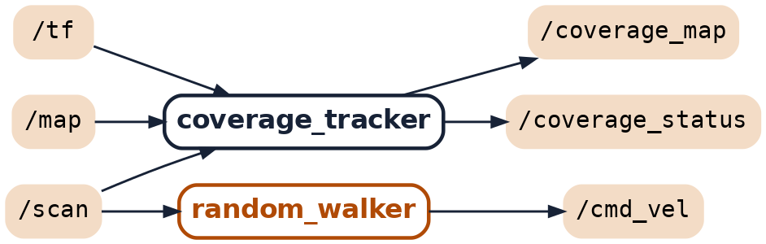

# Nœuds et topics du projet : l'essentiel

## 1. Les définitions

**Nœud** : un petit programme qui tourne tout seul et qui a **une seule responsabilité** (par exemple : décider de la vitesse du robot). Un système ROS 2, c'est plusieurs nœuds qui tournent en même temps et qui s'échangent des informations.

**Topic** : un **canal de discussion nommé**, par exemple `/scan`. Un nœud **publie** des messages sur un topic ; d'autres nœuds **s'abonnent** à ce topic et les reçoivent. Celui qui publie ne sait pas qui écoute : on peut ajouter un abonné (RViz, un enregistrement rosbag) sans rien modifier. Image : une station de radio ; le nœud qui publie est l'émetteur, les abonnés sont les postes réglés sur cette station.

**Message (et son type)** : ce qui circule sur un topic. Son **type** fixe son contenu : `sensor_msgs/LaserScan` = les distances mesurées par le LiDAR ; `geometry_msgs/Twist` = une vitesse d'avance et une vitesse de rotation.

**Action** : une demande longue, avec des nouvelles en cours de route et un résultat à la fin (« suis ces points de passage », « j'en suis au point 12 », « terminé »). Un topic, lui, envoie des messages sans attendre de réponse.

**TF** : le système qui donne la position de chaque repère par rapport aux autres : `map` (la carte) → `odom` (point de départ de l'odométrie) → `base_footprint` (le robot). En les enchaînant, on obtient la position du robot sur la carte.

**Fichier launch** : un fichier (`xxx.launch.py`) qui démarre d'un coup tous les nœuds nécessaires, avec leurs réglages.

Pour voir tout ça en direct : `ros2 node list`, `ros2 topic list`, `ros2 topic echo /coverage_status`, `rqt_graph`.

## 2. Nos nœuds (écrits par l'équipe)

| Nœud | Stratégie | Lit | Publie | Rôle en une phrase |
|---|---|---|---|---|
| `random_walker` | A | `/scan` | `/cmd_vel` | Avance ; si un obstacle est à moins de 25 cm devant, tourne d'un angle tiré au hasard (90 à 180°). |
| `coverage_planner` | B | `/map` | `/coverage_path` | Calcule le plan de balayage : lignes parallèles tous les 20 cm, à 20 cm des murs. |
| `coverage_executor` | B, simulation | `/coverage_path`, `/odom`, `/amcl_pose` | `/initialpose`, action `follow_waypoints` | Donne la position de départ à AMCL, puis confie les points du plan à Nav2 et surveille que le robot avance. |
| `coverage_follower` | B, robot réel | `/coverage_path`, `/scan`, TF | `/cmd_vel` | Remplace Nav2 : tourne vers le point suivant, puis avance ; s'arrête devant un obstacle. |
| `coverage_tracker` | A et B | TF, `/map`, `/scan` | `/coverage_status`, `/coverage_map` | Le nœud de mesure, le même pour A et B : compte la surface couverte, la distance et les obstacles frôlés, écrit le CSV. |

## 3. Les nœuds fournis par ROS 2 (outils du cours)

| Nœud | Rôle |
|---|---|
| Gazebo (plugins du robot simulé) | Simule le robot : publie `/scan` (LiDAR), `/odom` et la TF (roues), exécute `/cmd_vel`. Sur le vrai robot, c'est le programme du TurtleBot3 qui joue ce rôle. |
| `map_server` | Publie la carte `/map`, enregistrée après la cartographie. |
| AMCL | Calcule où est le robot sur la carte en comparant le LiDAR à la carte ; publie la TF `map → odom` et `/amcl_pose`. Utilisé seulement pour B en simulation. |
| Nav2 | Conduit le robot de point en point : calcule une trajectoire, évite les obstacles, publie `/cmd_vel`. Utilisé seulement pour B en simulation. |
| `robot_state_publisher` | Publie la forme du robot et ses repères internes dans la TF. |
| RViz | Affiche la carte, le plan (vert), la couverture (rose) et le LiDAR (rouge). |
| `static_transform_publisher` (`map_to_odom`) | Publie une TF `map → odom` fixe quand on n'utilise pas AMCL (stratégie A, robot réel). |

## 4. Les topics utilisés

| Topic | Type de message | Publié par | Lu par | Contenu |
|---|---|---|---|---|
| `/scan` | `sensor_msgs/LaserScan` | LiDAR (Gazebo ou robot réel), environ 5 fois/s | `random_walker`, `coverage_tracker`, `coverage_follower`, Nav2, AMCL | Les distances mesurées tout autour du robot |
| `/cmd_vel` | `geometry_msgs/Twist` | `random_walker` (A), Nav2 (B simulation), `coverage_follower` (B réel) | les roues | La vitesse demandée : avance (m/s) et rotation (rad/s) |
| `/odom` | `nav_msgs/Odometry` | les roues | Nav2, AMCL, `coverage_executor` | La position estimée avec les roues seules |
| `/map` | `nav_msgs/OccupancyGrid` | `map_server` | `coverage_planner`, `coverage_tracker`, Nav2, RViz | La grille de la pièce : chaque case de 5 cm est libre, occupée ou inconnue |
| `/coverage_path` | `nav_msgs/Path` | `coverage_planner` | `coverage_executor`, `coverage_follower`, RViz | Le plan de B : la liste des points de passage |
| `/coverage_status` | `aspi_interfaces/CoverageStatus` (notre type) | `coverage_tracker`, 1 fois/s | enregistrement, nous | % couvert, distance, temps écoulé, obstacles frôlés |
| `/coverage_map` | `nav_msgs/OccupancyGrid` | `coverage_tracker`, 1 fois/s | RViz | Les cases déjà couvertes (le rose dans RViz) |
| `/tf` | `tf2_msgs/TFMessage` | roues, AMCL ou `map_to_odom`, `robot_state_publisher` | `coverage_tracker`, `coverage_follower`, Nav2, RViz | Les positions des repères les uns par rapport aux autres |
| `/initialpose` | `geometry_msgs/PoseWithCovarianceStamped` | `coverage_executor` | AMCL | La position de départ du robot sur la carte |
| `/amcl_pose` | `geometry_msgs/PoseWithCovarianceStamped` | AMCL | `coverage_executor` | La position du robot calculée par AMCL |
| action `follow_waypoints` | `nav2_msgs/action/FollowWaypoints` | appelée par `coverage_executor` | servie par Nav2 | « Suis ces points de passage », avec le point en cours et le résultat |

## 5. Les trois chaînes à savoir réciter

- **A** : LiDAR → `/scan` → `random_walker` → `/cmd_vel` → roues. Une boucle fermée, 10 décisions par seconde. Le robot n'utilise pas la carte.
- **B en simulation** : `map_server` → `/map` → `coverage_planner` → `/coverage_path` → `coverage_executor` → action `follow_waypoints` → Nav2 → `/cmd_vel` → roues.
- **B sur le robot réel** : `coverage_planner` → `/coverage_path` → `coverage_follower` → `/cmd_vel` → roues (sans Nav2 ni AMCL).
- **La mesure, pour A et B** : TF + `/map` + `/scan` → `coverage_tracker` → `/coverage_status`, `/coverage_map` et le fichier CSV.

## 6. Les graphes réels (rqt_graph, nos nœuds seulement)

Stratégie A en marche :

Stratégie B en simulation (pointillés : action Nav2) :

