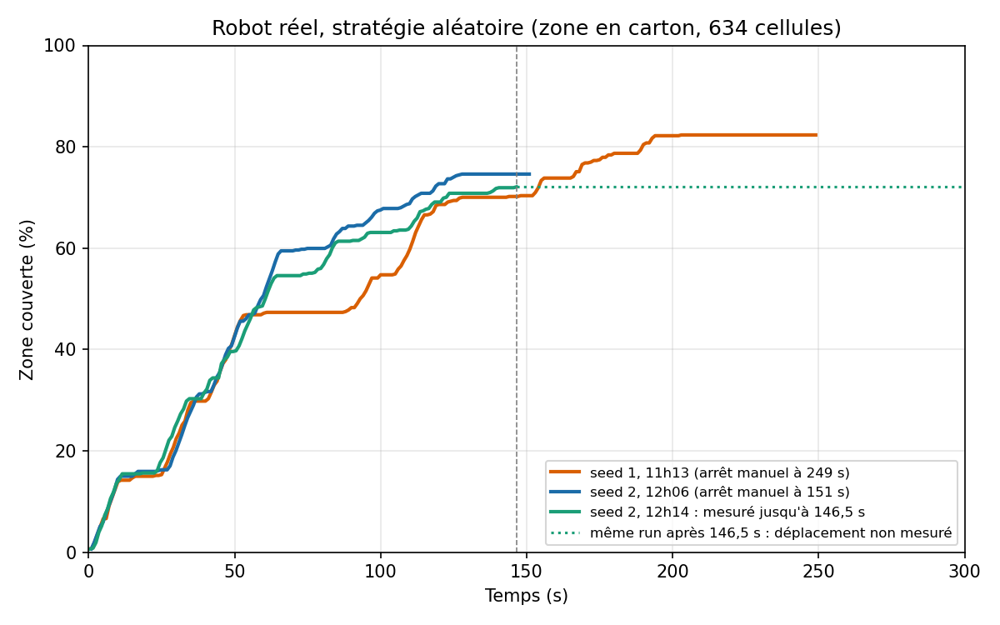

# Résultats : stratégie A (aléatoire) contre stratégie B (boustrophédon + Nav2)

Tous les chiffres viennent des CSV de `results/`, du résumé `results/summary.md` et du `docs/JOURNAL.md`, sauf la section 4 bis, qui est un calcul hors ligne (signalé comme tel).
**Méthode des « % à t s »** : partout, interpolation linéaire entre les deux points CSV voisins (fonction `cov_a` de `scripts/plot_results.py`).
Les figures et le tableau sont produits par `scripts/plot_results.py`.

## 1. Protocole appliqué

- **Monde** : `turtlebot3_world` (une seule pièce).
- **Départ** : (-2.0, -0.5), qui est aussi l'origine de la carte de référence.
- **Durée** : 600 s simulées par run.
- **Métrique commune** : le même nœud `coverage_tracker` pour A et B.
  - Dénominateur : un masque d'espace atteignable de 5564 cellules, soit 13.9 m².
  - Une cellule est couverte quand le robot passe à moins du rayon de nettoyage (disque). Rayon de 0.09 m demandé, arrondi à 2 cellules (0.10 m) par le code (disque de 13 cellules, bande nettoyée d'environ 0.25 m par passage).
  - La mesure démarre au premier déplacement du robot.
- **Vitesse d'avance identique** : 0.15 m/s pour A et B.
- **Stratégie A** : 3 runs, seeds 1, 2, 3, en mode **accéléré** (Gazebo sans limite de temps réel, sans fenêtres).
  - Ce mode a été validé par 5 critères fixés avant les runs (fréquences de `/scan` et `/cmd_vel`, vitesse moyenne, near_collisions, % final).
  - Les 5 critères sont satisfaits (`results/comparaison_vitesse/`). Les deux courbes, accélérée et temps réel, sont quasi superposées jusqu'à environ 5 min.
- **Stratégie B** : 3 runs, seeds 1, 2, 3, en **temps réel**, configuration Nav2 finale appelée T5.
  - Le mode accéléré a été testé et **invalidé** pour Nav2 (`results/comparaison_vitesse_B/`). Fréquence du contrôleur 4.42 Hz contre 9.56 Hz en temps réel (10 Hz configurés), 8 waypoints atteints contre 69 en temps réel, 85 incidents contre 1.
  - Le critère « % final » seul paraissait bon (56.8 % contre 54.1 %). Il était trompeur : à 300 s, 53.6 % contre 29.0 %.
- **Comparaison** : en temps simulé. Chaque stratégie est mesurée dans un mode dont le comportement en temps simulé a été vérifié.

## 2. Résultats

### Figures

- `results/coverage_vs_time.png` : moyenne (trait épais), runs individuels (pointillés) et enveloppe min/max, par stratégie.
- `results/coverage_vs_time_runs.png` : un sous-graphe par stratégie, chaque run étiqueté par sa seed.

La seconde figure montre le run B3 : sa courbe devient plate à 17.2 %. Sur la première figure, il forme le bas de l'enveloppe de B.

### Tableau par run

| Stratégie | Seed | Durée | % final | % à 300 s | Temps pour 80 % | Distance (m) | near_collisions |
|---|---|---|---|---|---|---|---|
| A (RANDOM) | 1 | 600 s | 54.4 % | 24.8 % | non atteint | 71.9 | 24 |
| A (RANDOM) | 2 | 601 s | 55.5 % | 26.3 % | non atteint | 70.5 | 32 |
| A (RANDOM) | 3 | 601 s | 43.3 % | 31.7 % | non atteint | 70.0 | 21 |
| **A moyenne ± écart-type** | n=3 | | **51.0 ± 6.7 %** | 27.6 ± 3.6 % | non atteint | 70.8 ± 1.0 | 25.7 ± 5.7 |
| B (BOUSTROPHEDON) | 1 | 600 s | 59.8 % | 30.5 % | non atteint | 70.2 | 0 |
| B (BOUSTROPHEDON) | 2 | 600 s | 55.4 % | 30.6 % | non atteint | 62.2 | 2 |
| B (BOUSTROPHEDON) | 3 | 600 s | 17.2 % | 17.2 % | non atteint | 29.5 | 25 |
| **B moyenne ± écart-type (officielle, 3 runs)** | n=3 | | **44.1 ± 23.4 %** | 26.1 ± 7.7 % | non atteint | 54.0 ± 21.5 | 9.0 ± 13.9 |

L'écart-type est celui de l'échantillon (n-1).

**Information complémentaire** : 2 runs sur 3 terminés normalement (B1 et B2) : **57.6 % en moyenne**. Ce chiffre est donné à titre indicatif. Le résultat principal reste la moyenne à 3 runs.

### Lecture rapide

- **80 % n'est atteint par aucun run**, ni en A, ni en B. Le meilleur run est B1 avec 59.8 %.
- Autres seuils, à titre de repère : 50 % est atteint à 473 s par B1 et B2, à 566 s et 561 s par A1 et A2. A3 et B3 ne l'atteignent jamais.
- À 300 s, les moyennes sont proches : 27.6 % (A) contre 26.1 % (B).
- Distance : A parcourt environ 70 m dans chaque run. B1 et B2 en parcourent 70.2 et 62.2. B3 en parcourt 29.5 (bloqué).
- near_collisions : 25.7 en moyenne pour A. Pour B, 0 et 2 sur les deux runs normaux, 25 sur le run bloqué.

## 3. Décision méthodologique : le run B3 est conservé

Le run B3 s'arrête à 17.2 %. Sa couverture n'augmente plus après environ 158 s.

- **Cause observée** : à environ 135 s simulées, la TF `map → odom` vue par Nav2 reste figée, alors qu'AMCL continue de la publier (5 Hz, rosbag). Nav2 croit le robot immobile et enchaîne échecs de progression et recoveries.
- **Déjà vu** : en essai T1 et en mode accéléré.
- **Cause non identifiée** : charge CPU sous WSL, DDS ou buffer TF sont des pistes, aucune n'est vérifiée.
- **Décision de l'étudiant** : B3 reste dans la moyenne officielle (44.1 ± 23.4 %). La moyenne des 2 runs normaux (57.6 %) est indiquée à côté, comme information complémentaire.
- **Justification** : on n'écarte pas un résultat après l'avoir vu. Le blocage est une limite de fiabilité de la pile B dans notre environnement.

## 4. Interprétation (prudente)

- **Début de run** : les courbes MOYENNES de A et de B restent à moins de 4 points l'une de l'autre jusqu'à 540 s, mais parce que B3 tire la moyenne de B vers le bas ; B1 et B2, eux, devancent la moyenne de A dès environ 4 min (détail ci-dessous).
- **Fin de run** : sur ses deux runs complets, B passe devant (55.4 % et 59.8 %, contre 43.3 à 55.5 % pour A). L'écart apparaît tard dans le run.
- **Deux lectures des courbes, selon ce qu'on moyenne** :
  - Les **moyennes** de A et de B (B avec B3) restent à moins de 4 points l'une de l'autre jusqu'à 540 s (écart maximal 3.8 points). C'est parce que B3, bloqué à 17.2 %, tire la moyenne de B vers le bas.
  - Si l'on compare la moyenne de A à la moyenne de B1 et B2 seuls, B1 et B2 devancent la moyenne de A dès environ 4 min (à partir de 233 s, de façon durable) : +3.0 points à 300 s, +5.4 à 420 s, +10.8 à 480 s (+6.5 à 600 s). Ces écarts portent sur 2 runs de B contre 3 de A.
- **Sécurité** : B fait nettement moins de near_collisions (0 et 2) que A (21 à 32). C'est cohérent avec une trajectoire calculée sur la carte et un évitement d'obstacles par Nav2. Hypothèse non vérifiée : A ne réagit qu'au dernier moment (il s'arrête à 0.25 m dans un cône de ±30°), alors que near_collisions compte les passages sous 0.15 m sur 360°. Les deux seuils et les deux secteurs diffèrent, donc la comparaison de ce compteur entre A et B reste indicative.
- **Objectif non atteint** : aucune stratégie ne couvre 80 % en 10 min.
- **Pas de conclusion statistique ferme** sur le % final. Avec n = 3 et une dispersion de B de 23.4 points, les intervalles de A et B se recouvrent largement.
- **Régularité** : B1 et B2 ont des courbes presque identiques sur la majeure partie du run, car le trajet est planifié. A varie plus d'un run à l'autre en cours de route (par exemple à 420 s : 28.4 % pour A1 contre 40.3 % pour A3).
- **Reproductibilité (observation sur la figure `results/coverage_vs_time_runs.png`, 2 runs)** : quand Nav2 fonctionne, B1 et B2 sont quasi superposées jusqu'à environ 8 min, alors que les runs de A divergent dès environ 2 min. Le balayage est déterministe, l'aléatoire ne l'est pas. La variance de B vient de la fiabilité (B3), pas de la stratégie. Cela reste une observation sur deux runs, pas une démonstration.
- **Où B perd du temps** (analyse du journal, runs de réglage) :
  - rotations sur place : environ 18 % du temps (T3 et T5, 600 s) ; 16 % sur T3 à 300 s ;
  - petits segments entre deux lignes de balayage, avec des arrêts d'environ 30 s ;
  - lignes de balayage coupées par les obstacles (le pilier), avec rotation puis contournement d'environ 13 s.
- **Ce que A fait gratuitement** : pas de carte, pas de localisation, pas de planification. Il dépend de moins de composants, donc de moins de pannes. Sur les runs officiels, un run sur trois de B s'est bloqué de cette façon. Aucun run de A n'est documenté comme bloqué.

## 4 bis. Pourquoi 80 % n'est pas atteint : borne optimiste calculée (pas une mesure)

Calcul hors ligne avec `planning.py` sur `maps/world.pgm` : masque atteignable (5564 cellules), `boustrophedon_waypoints` (112 waypoints), puis marquage de la couverture le long des segments droits avec un rayon de 2 cellules. Le robot est supposé parfait : aucun détour, aucun arrêt, aucune rotation.

- Un balayage idéal couvrirait 99.8 %.
- Longueur du trajet idéal en lignes droites : 91.7 m, sans détours.
- Il faut au moins 75.7 m de trajet pour atteindre 80 %, soit au moins 505 s de translation pure à 0.15 m/s.
- À 70.2 m (distance parcourue par B1), la couverture idéale serait de 76.3 %, contre 59.8 % mesurés.

Lecture prudente : avec 600 s et 0.15 m/s, la marge est faible même pour un robot parfait (90 m parcourables au maximum). Les rotations, les arrêts et les contournements mesurés en B, ainsi que les recouvrements de A, expliquent que 80 % ne soit pas atteint. Ce calcul est une borne, pas une mesure : il ne dit pas quelle part de l'écart vient de chaque cause.

## 5. Historique des réglages de B (démarche d'ingénierie)

Essais en temps réel. Un facteur modifié à la fois, mesuré séparément. Les essais T1 à T4 durent 300 s. T0 et T5 ont aussi un run de 600 s. T3 a un run de 600 s dans `results/comparaison_vitesse_B/`.

| Essai | Modification | % à 300 s | % à 600 s | Constat |
|---|---|---|---|---|
| T0 | config TurtleBot3 d'origine (DWB) | 19.5 % | 33.2 % | `loop_rate` à 2000 Hz, CPU saturé, blocages près du pilier et des murs |
| T1 | `loop_rate` du waypoint_follower à 20 | 18.2 % | | surcharge CPU supprimée, comportement inchangé |
| T2 | T1 + inflation 0.30 m, `cost_scaling` 10 | 21.9 % | | début plus rapide, mais blocage devant le pilier dès 177 s (DWB oscille) |
| T3 | contrôleur Regulated Pure Pursuit, 0.15 m/s, rotation 1.0 rad/s | 28.5 % | 54.1 % | plus de blocage, 1 near_collision à 300 s |
| T4 | T3 + contournements calculés par notre planner | 22.4 % | | **impasse** : 245 waypoints au lieu de 112, replanification à chaque but. Code conservé, désactivé |
| T5 | T3 + ralentissement d'approche réduit (0.2 m), pause aux waypoints à 0 | 30.6 % | 59.7 % | gain net, **configuration retenue** |

- T3 et T5 ont été comparés avec une seule seed chacun (seeds 1 et 5). La différence ne suffit pas à conclure statistiquement.
- Les runs officiels (seeds 1 à 3) sont refaits en configuration T5.
- Leçon : un réglage « officiel » peut contenir des valeurs inadaptées à la couverture. Les paramètres de sécurité de Nav2 sont pensés pour aller d'un point à un autre, pas pour longer les obstacles.
- Sources : `results/reglages_B/`, `results/comparaison_vitesse_B/`, `docs/JOURNAL.md`.

## 6. Limites

- **Peu de runs** : 3 par stratégie. Les écarts-types sont peu fiables. Aucun test statistique n'est proposé.
- **Une seule pièce** : `turtlebot3_world`, de 13.9 m² atteignables. Les résultats ne se généralisent pas à d'autres plans.
- **Odométrie parfaite en simulation** : A ne dérive pas. En conditions réelles, A serait mesuré avec une dérive, donc moins fiable. Le TF statique `map → odom` de A suppose cette absence de dérive.
- **Mesure de B sur la pose AMCL** : la position de B pour la couverture est estimée par AMCL, celle de A vient de l'odométrie simulée. Les deux sources n'ont pas la même erreur.
- **Modes de simulation différents** : A en accéléré, B en temps réel. Chaque choix est justifié par une validation, mais ce n'est pas le même banc.
- **Origine de la carte** : la TF `map → base_footprint` vaut environ (0.037, 0.009) m au départ (journal), car Cartographer prend son repère de suivi comme origine. Le décalage est d'environ 4 cm, inférieur à une cellule (5 cm).
- **Discrétisation** : la carte a des cellules de 5 cm. L'espacement effectif des lignes de balayage de B est de 0.20 m, pour 0.18 m demandé.
- **Blocage de la TF non diagnostiqué** : la cause du blocage de B3 est inconnue. Il peut se reproduire.
- **Blocages au démarrage de Nav2** : l'executor est resté bloqué au démarrage 2 fois sur 5 lancements avant correctif (journal). Le correctif est validé seulement par les runs officiels.
- **Facteur temps réel** (temps simulé / temps mural), mesuré sur les runs officiels : B1 0.91, B2 0.84, B3 0.94 (temps réel, donc inférieur à 1) ; A en mode accéléré ×2.84, ×3.06, ×3.08 (seeds 1, 2, 3). Un facteur inférieur à 1 en B peut jouer sur les cadences de Nav2.
- **Seeds de B** : le trajet planifié est le même d'un run à l'autre. Les différences entre runs de B viennent des aléas d'exécution (Nav2, AMCL, machine), pas d'un tirage aléatoire comme en A.

## 7. Robot réel (séance du 2026-10-09)

Cette section est indépendante des sections 1 à 6 (simulation). Tous les chiffres viennent des CSV de `results/robot_reel/`. Les « % à t s » sont interpolés linéairement entre deux points CSV, comme en section 2. La figure et ces valeurs sont reproductibles avec `scripts/plot_robot_reel.py`.

### 7.1 Conditions

- **Robot** : TurtleBot3 Burger réel, LiDAR LDS-02.
- **Zone** : un enclos en carton, carte `zone_reelle`. Le masque d'espace atteignable compte **634 cellules, soit environ 1,6 m²**, avec le seuil de carte utilisé pendant les runs. Avec le seuil corrigé (0.19, voir journal), il compte 620 cellules : un écart de 2 %, signalé en limites.
- **Vitesse d'avance** : 0.10 m/s (0.15 m/s en simulation).
- **Seuil de near_collision** : 0.20 m (valeur supérieure à la portée minimale du LDS-02).
- **Durée prévue** : 300 s par run.
- **Localisation pour la mesure** : AMCL sur la carte `zone_reelle`. Le même `coverage_tracker` que pour la simulation.
- **Stratégie testée** : A (aléatoire) seulement. La stratégie B est restée bloquée sur le robot réel (Nav2 inactif, voir journal) : aucun run B réel.

### 7.2 Tableau de tous les runs

| CSV (RANDOM_seed_horodatage) | Durée mesurée | % à 60 s | % à 120 s | % à 146 s (ou fin) | % final | Distance (m) | near_collisions | Statut |
|---|---|---|---|---|---|---|---|---|
| 1_20261009-102808 | 300,5 s | 66,9 | 79,4 | 79,4 | 79,4 | 7,06 | 255 | Exclu : première zone de 0,95 m² (cartons trop serrés), autre dénominateur |
| 1_20261009-111324 | 249,0 s | 47,2 | 68,6 | 70,2 | 82,3 | 17,32 | 17 | Valide, incomplet (arrêt manuel à 249 s) |
| 2_20261009-113503 | 300,3 s | 37,5 | 37,5 | 37,5 | 37,5 | 4,37 | 23 | Invalide : mesure figée (horloge du robot) |
| 2_20261009-114326 | 91,9 s | 10,7 | 10,7 (fin à 91,9 s) | 10,7 (fin) | 10,7 | 0,74 | 23 | Invalide : mesure figée (`/tf_static` perdu) |
| 2_20261009-120622 | 150,9 s | 50,8 | 72,7 | 74,6 (fin) | 74,6 | 12,03 | 33 | Valide, incomplet (arrêt manuel à 151 s) |
| 2_20261009-121427 | 300,5 s | 49,3 | 69,1 | 72,1 (à 146,5 s) | 72,1 | 11,94 | 95 | Valide jusqu'à 146,5 s seulement (voir ci-dessous) |

Notes de lecture :

- Le run 102808 (sur l'ancienne zone) n'est pas comparable : zone de 0,95 m², 255 near_collisions. Sa couverture se fige à 79,4 % dès 96,5 s et sa distance à 7,06 m dès 135,5 s. Il est exclu des figures et de l'interprétation.
- Le run 113503 est figé à 37,5 % (distance 4,37 m) depuis 54,3 s ; le run 114326 est figé à 10,7 % depuis 9,9 s. Pour 113503, les near_collisions passent de 5 (à 60 s) à 23 (en fin de run) alors que la distance ne bouge plus : ce ne sont pas des mesures de déplacement.
- **Run 121427** : sa couverture (72,1 %) et sa distance (11,94 m) sont **figées de 146,5 s à 300,5 s**, alors que near_collisions continue de croître (50 à 146,5 s, 84 à 248,5 s, 95 en fin de run). Plus aucun déplacement n'est mesuré après 146,5 s. La cause (robot arrêté physiquement, ou pose mesurée figée) n'est **pas tranchée** : il n'y a pas de rosbag. On ne retient donc ce run que jusqu'à 146,5 s : 72,1 % pour 11,94 m et 50 near_collisions. Les valeurs « finales » de la ligne (300,5 s, 95) ne doivent pas être lues comme une mesure de 300 s.
- Le run 111324 est le seul à dépasser 80 % : 80,4 % à 190 s, 82,3 % à 249 s.

### 7.3 Figure

`results/robot_reel/coverage_vs_time_reel.png` : les trois runs valides, chacun étiqueté. Pour le run 121427, la portion après 146,5 s est tracée en pointillés (« déplacement non mesuré »). Pas de moyenne : trois runs incomplets de durées différentes.

### 7.4 Interprétation (prudente)

- Sur cette zone d'environ 1,6 m², les trois runs valides sont à **68,6 à 72,7 % à 120 s** et à **70,2 à 74,6 % à 146 s**. La stratégie aléatoire atteint donc environ 70 % en 2 à 2,5 minutes. Un seul run (111324) dépasse 80 % (à 190 s).
- Les trois courbes se ressemblent jusqu'à 50 s environ (autour de 47 à 51 % à 60 s). Elles divergent ensuite (par exemple 47,2 %, 50,8 % et 49,3 % à 60 s, puis plateaux à des moments différents). Avec trois runs courts, on ne peut pas chiffrer la variabilité.
- **Pas de comparaison A/B réelle** : B n'a pas pu être exécutée.
- **Pas de comparaison directe avec la simulation** : zone environ 9 fois plus petite (1,6 m² contre 13,9 m²), durée différente, vitesse 0.10 m/s au lieu de 0.15 m/s, localisation AMCL au lieu de l'odométrie simulée. Les pourcentages ne sont pas transposables.
- near_collisions : 17 à 33 sur les runs valides jusqu'à leur fin (50 pour 121427 à 146,5 s), contre 21 à 32 en simulation sur 600 s. Ces valeurs sont plus élevées par unité de temps, ce qui s'explique plausiblement par la zone exiguë et le seuil de 0.20 m, mais la cause n'a pas été isolée par une expérience.

### 7.5 Limites propres au robot réel

- **Peu de runs** : trois runs valides, tous incomplets ; aucun run de 300 s entièrement valide. Deux seeds seulement (1 et 2), la seed 3 n'a pas été jouée.
- **Pas de rosbag** : le blocage de la mesure du run 121427 ne peut pas être rejoué ni diagnostiqué.
- **Seuil de carte** : 634 cellules (seuil utilisé) contre 620 (seuil corrigé 0.19), soit 2 % d'écart sur le dénominateur. Les pourcentages sont donnés avec le dénominateur de 634.
- **Horloge du robot** : sans Internet ni horloge sauvegardée, le robot repart d'une date ancienne à chaque extinction. Les écarts d'horloge ont rejeté des TF et figé deux runs. La remise à l'heure est manuelle.
- **Une seule zone, un seul robot**. La zone a changé après le premier essai (0,95 m² puis 1,6 m²) : seul le second dispositif est retenu.
- **Arrêts manuels** : deux runs valides sont interrompus à la main (249 s et 151 s), les durées ne sont pas comparables entre elles.
